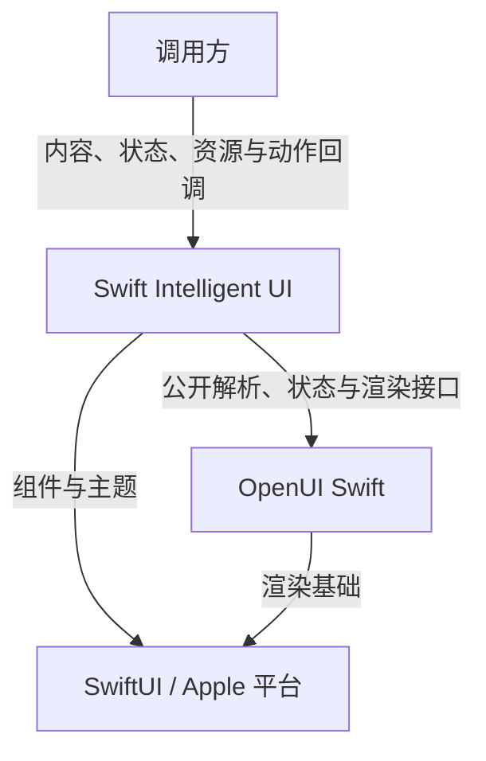

# Swift Intelligent UI 方案

交付版本：0.1.0-preview.25（地图筛选恢复与稳定轮播定位） · 日期：2026-11-06

本轮根据实际截图统一组件视觉，优先对齐用户给出的ChatGPT移动端结构。停止新的批量生成与逐候选UI矩阵；完成必要代码检查与构建后更新真实聊天客户端，由用户直接发起真实查询。历史首轮输出和失败证据保留，不以自动化通过宣称视觉达到目标。

此前的preview.14、trace.1、rc.1与rc.2包及失败证据保持不可变；本次仅本地交付，不远程发布。

本轮基于人工截图统一价格字段、标签和动作行，去掉自动商品详情；地图补前后/筛选及同源绑定示例，表格提供原生默认列宽与行样式。此前版本与人工实测原文保持不可变，不恢复批量生成或候选UI矩阵。

本文统一维护架构、目录、组件契约、设计原则、接入方式与验收结果。

基础组件语义以第25节固定上游对照为准；本轮按用户提供的ChatGPT截图调整视觉，具体覆盖项见第26节。此前各preview章节保留历史记录；不删除组件，不更改六个新增组件的数据契约或实现，Map保留图内卡片及联动支持。

## 1. 定位与边界

Swift Intelligent UI 是基于 OpenUI Swift 的 Apple 平台组件库，提供 Design System、组件、交互绑定和生成规范。布局、文字、图片、输入、商品、交通和图表遵循同一套组件机制。卡片由本库原生实现，与其他内容统一使用本库视觉系统。

调用方持有 OpenUIState、提供内容与资源、接收动作事件。库通过 OpenUI Swift 的公开接口复用解析、求值、状态、流式与渲染遍历。模型生成验证仅位于 Benchmarks。



## 2. 目录与职责

统一库模块为 `SwiftIntelligentUI`，内部按职责和 UI 能力分类。

```text
open-intelligent-ui-swift/
├── Package.swift
├── Package.resolved
├── THIRD-PARTY-NOTICES.txt
├── Sources/SwiftIntelligentUI/
│   ├── IntelligentUIView.swift
│   ├── Catalog/                 # 组件注册与契约辅助
│   ├── DesignSystem/            # 系统语义色、字体、间距和形状
│   ├── Components/
│   │   ├── Layout/
│   │   ├── Content/
│   │   ├── Controls/
│   │   ├── Media/
│   │   └── DataDisplay/
│   ├── Functions/               # 固定计算代码的受控桥接
│   ├── Generation/              # spec、Prompt 与 manifest
│   └── Resources/               # 计算、公式与许可资源
├── Tests/SwiftIntelligentUITests/
├── Examples/Gallery/
│   ├── GalleryApp.swift         # iOS/macOS 共用固定案例
│   ├── Resources/               # 仅 Gallery 使用的来源照片
│   └── IntelligentUIGallery.xcodeproj/
├── Tools/
│   ├── ContractExport/
│   ├── Functions/               # 固定上游计算源码与生成工具
│   └── package.py
├── Benchmarks/
├── docs/swift-intelligent-ui-design.md
└── outputs/                     # 本地导出、验收证据与交付包
```

组件定义与实现相邻，复杂组件在自己的文件或子目录内维护辅助类型。Catalog 聚合实际实现，Generation 读取同一个注册库。商品卡在 DataDisplay 中按普通组件维护。

SwiftPM 的 Sources/Tests 目录按 target 命名；库、Gallery、导出工具和测试分别建立 target。消费者引入库产品时，不依赖 Gallery 或开发工具。

## 3. 组件与契约

实现覆盖固定上游的 55 个组件入口，并增加本库的内容与交通展示组件。默认注册 60 个组件：54 个上游入口与本库 ProductCard、TransportCard、ImageText、Citation、Disclosure、Progress；注入图片搜索服务后注册 SearchImage，总计 61 个。数量表示入口覆盖，具体参数和平台行为以导出的 spec、manifest 为准。

| 分类 | 组件 |
|---|---|
| Layout | Col、Row、Box、Grid、Card、Carousel、Popover、Divider、Spacer、Form、Disclosure |
| Content | Text、Title、Caption、Label、Badge、Link、List、ListItem、Markdown、Quote、Code、Flashcard、Celebration、ImageText、Citation |
| Controls | Button、IconButton、Pressable、Input、TextArea、Select、SegmentedControl、RadioGroup、Slider、Checkbox、DatePicker、Timer |
| Media | Image、Icon、SearchImage、Math、Map、MapMarker、YouTube、HtmlView、Svg、Circle、Ellipse、Rect、Line、Path、Polyline、Polygon、G、SvgText |
| DataDisplay | Table、Chart、ProductCard、TransportCard、Progress |

每个组件记录有序参数、类型、默认行为、绑定与限制。渲染和生成规范使用同一份注册定义。未配置的 SearchImage 不进入默认模型规范。

主要平台映射：

- 长度使用 Apple point；Box 和 Svg 的尺寸接受数值，不解释任意 CSS 长度。
- 颜色使用语义 token；SVG 接受经过检查的颜色字符串。图标使用明确枚举的 Lucide 名称到 SF Symbols 映射。
- Carousel 使用可用宽度收敛卡宽、等高排列，iOS 17/macOS 14 起使用原生卡片停靠，旧系统保留原生横向滚动；桌面提供上一项/下一项按钮。Row 支持逐项换行、对齐和剩余空间分配；Grid 的自适应列数不超过 columns。无障碍大字号下 Grid 使用单列。
- Box 的 wrap 用于 row 方向；flex 用于非换行 Row。列方向按原生纵向布局处理。
- Text 支持内联 Markdown 和混排组件；混排按原生布局换行，maxLines 作用于文字段。Markdown 提供完整文档块排版。
- Button 使用原生按钮风格；没有动作时禁用。Pressable 和 Popover 的触发内容用于展示，避免嵌套交互控件。
- 输入绑定到显式变量；字面量只读。数值草稿保留中间输入，空值写入 null，无效草稿不覆盖上一有效值。
- Select 和选择组使用首个同值选项；未知值保持未选择。短选项使用原生分段控件，窄屏或大字号时重排。
- DatePicker 使用 Gregorian 日历日期，严格校验 YYYY-MM-DD；Timer 按经过的时间递减，离开界面暂停。
- Table 按行顺序保持 UI 身份，数字列右对齐；无障碍大字号下改为带字段名的纵向条目。
- Chart 提供柱、线、面积、散点、饼和环形。缺失数字不补成零。支持点选、横向拖动和悬停探查，selected 可绑定所选类别；数值通过锚定 Popover 展示，也保留可访问的原生数值选择控件。紧凑平台在 iOS 16.4 起保持 Popover，较旧系统可按系统规则自适应。饼/环形可点选扇区。完整数据可展开核对，大字号直接呈现数据明细。
- Map使用MapKit与SDK统一摘要卡：内嵌默认360点，主题范围300–400点，大字号400点，不随内容增长。content复用Card/ImageText/Carousel，图内ImageText固定为64点方图、两行名称与一行辅助信息；原top/leading、大正文和来源footer不改变地图摘要形态，完整详情按任务放地图外。基础卡同型且不编造照片。Map与Carousel共享地点id/selected，卡片内横滑切换。顶部只保留fit-all与展开/关闭；route仍是直线，不计算道路路线，不请求用户位置。
- Math 使用固定 KaTeX 在本地生成 MathML，由 WebKit 排版；SVG 使用脚本关闭的本地 WebKit。它们属于明确的平台桥接。
- HtmlView 使用独立非持久 WebKit，没有原生消息桥。仅完整内容开始运行，允许内联脚本，限制网络及导航；默认高度 360 point，可内部滚动。切换外观不重载页面状态。
- YouTube 使用隐私增强播放器，需要网络与用户播放操作。无效地址显示错误。

## 4. Apple 原生视觉与行为

整体采用接近 ChatGPT 内容表达的杂志式排版，以正文、图片、留白和信息层级建立阅读顺序；字体、控件和交互遵循 Apple 平台习惯。

- **字体层级**：使用Apple默认系统字族与Dynamic Type，不指定衬线或圆体作为阅读字体。正文与辅助文字保持regular，常规标题和短语强调默认medium，最大展示标题与价格/交通时间保留semibold。Title、Text、Caption、List、Table、混排TextKit与Markdown共用主题的强调字重，Markdown标题不再隐式升级为bold。字体、Markdown相对标题比例与行距集中定义；代码保留等宽字体、计时器保留数字展示字体。模型使用语义层级，正文默认normal，只强调短语，不为标题重复套用Markdown粗体或整段半粗。中文、英文与金额保持自然换行。
- **阅读节奏**：Col 未指定 gap 时，开篇眉题紧接标题，标题靠近正文，连续段落保持阅读间距，图注靠近图片，章节之间增加留白。显式 gap 仍由调用方决定。
- **统一 token**：正文行距、段落间距、章节间距、内间距、价格字体、商品图片比例、阅读行宽与主操作前景/背景均由 IntelligentUITheme 提供。
- **操作层级**：主按钮采用统一的黑白动态配色，使用 borderedProminent；商品卡购买操作使用按文案宽度呈现的紧凑黑白主按钮；次操作使用 bordered 或轻量描边，低强调操作使用 borderless。正文中明确需要的链接保持次级样式，商品卡不附加来源入口。短选择优先原生 segmented Picker。
- **平台密度**：iOS 和 macOS 采用不同的控件高度初值；间距与圆角是项目 token，不宣称为 Apple 的统一硬性数值。
- **颜色与边界**：采用系统背景、分隔色、主次文字和动态外观。优先对齐、留白和轻分隔；卡片表示真实对象或分组。
- **数据表达**：Cartesian 图表使用 Swift Charts；图例、轴和明细协同表达。饼/环形以原生绘图实现并提供图例与明细。
- **导航**：Gallery 使用 NavigationSplitView、NavigationLink 和原生工具栏菜单；手机按系统规则折叠导航。
- **适配**：大字号通过重排、增高和展开明细保持可读，不整体缩小内容。主要操作有可访问名称，状态同时使用文字或形状提示。
- **反馈**：绑定修改直接影响结果；动作通过 SDK 派发。加载、缺图、错误、禁用和处理中状态与真实状态对应。

设计依据：[Apple Design Principles](https://developer.apple.com/design/human-interface-guidelines/design-principles/)、[Fonts](https://developer.apple.com/documentation/technologyoverviews/fonts)、[Buttons](https://developer.apple.com/design/human-interface-guidelines/buttons)。具体效果以运行画面与操作验收为准。

## 5. 状态、资源与计算

IntelligentUIView 接收外部创建的状态和匹配的 IntelligentUILibrary。makeState() 是创建正确 SDK 配置的便捷入口，状态生命周期仍由调用方持有。

同一状态实例支持完整输入、流式追加、绑定和派生计算。组件使用 SDK 上下文检查交互就绪和旧回调失效，不重复实现运行时。

默认内容宽度由 IntelligentUIView 读取 theme.readingWidth，接入方可通过同一主题调整，Gallery 不单独设置阅读宽度。

图片按来源加载；调用方可用 `.intelligentUIImages([source: Image])` 提供精确匹配的本地或已加载图片。图片搜索由 `IntelligentUIImageSearch` 注入，库不选择服务商。

59 个扩展函数复用固定上游的计算实现，通过 JavaScriptCore 执行。仅运行随包固定代码，输入按 JSON 数据传递；OpenUI 的解析和求值继续由 SDK 提供。桥接限制输入大小与嵌套深度，异常返回 null。原生组件和动作值不作为这些计算函数的数据输入。

函数参数来自固定上游生成规范，计算源码经过 Git blob 校验；每个扩展函数都有 golden case。时间测试可以注入 referenceDate，随机函数验证类型与边界。资源中保留上游、Zod 和 KaTeX 许可。

扩展动作 CopyToClipboard 以及 SDK 的 Set、OpenUrl、ToAssistant 交给调用方处理。相对链接保持原值，组件不自行进行交易。

Image、ProductCard 与 SearchImage 共用图片状态视觉：等待时在固定媒体区显示循环扫光骨架与无文字进度指示；失败或缺图时只显示低强调图形占位，不显示可见状态文案。远程加载失败与图片搜索失败都保留带无障碍名称的重试图标。解码图片由共享 ImagePipeline 缓存（40 张、64 MiB 成本上限），相同 URL/目标尺寸的并发请求合并；图像最长边默认下采样到 1600 像素，拒绝非成功 HTTP 响应和超过 20 MiB 的响应体。切换来源后不写入已失效视图任务的结果。状态说明供辅助技术朗读，减少动态效果时停用扫光。

Code 与 Markdown 代码块共用着色和复制操作：Swift、JS/TS、Python、JSON 与 shell 使用轻量词法着色，未知语言或超过 200 KB 的内容保留纯文本。复制派发原始 CopyToClipboard 事件，宿主负责系统剪贴板写入；Gallery 已实现该处理，不把事件发送当成未知宿主复制成功。

商品图与搜索结果图可点开原比例大图，支持缩放按钮、双击、捏合与滚动，关闭后回到原内容。通用 Image 通过追加的 preview 参数显式开启大图查看，默认保持展示语义，避免放入 Pressable 等控件时嵌套按钮。大图查看不执行外部业务动作。

Form 的可选 status 为 idle/submitting/success/error，message 为调用方提供的结果。提交中禁用内部字段与操作，结果不由库推断；Input、TextArea、Select 的 error 参数呈现统一字段错误。参数均追加在原有签名后，保留旧位置参数。

## 6. 商品组件

ProductCard 接受一个 product 对象和 layout。每张卡对应一个商品，价格和购买地址直接属于该商品。

- 必填：id、title、images；图片项包含 url、alt。
- 可选：priceText、specification、merchant、condition、availability、observedAt、purchaseURL、sourceURL。
- 布局：vertical、horizontal 或 compact；compact 用于地图内容等紧凑位置，缩略图在左、内容在右。窄屏横排和无障碍大字号重排为纵向。

商品卡大图默认采用主题统一的 3:2 比例；horizontal/compact 缩略图保持 1:1。horizontal按实际可用宽度分配图片和文字，极窄或无障碍大字号回退为纵向。imageFit可选参数默认为cover，适合复杂背景照片；contain适合需要完整展示的干净商品图，在固定3:2区域保留完整原图，背景由边缘低频取色并柔和过渡，不复制商品轮廓。预览仍展示原图；复杂照片的contain边界可能可辨，不承诺任意素材无缝。远程图片等待时保留等尺寸骨架、扫光和进度提示，减少动态效果时停用扫光。缺图保留异常区域，未知价格明确显示。未提供的可选信息不补占位文案，缺少有效购买地址时没有购买操作。价格按输入原文显示。

多个商品直接组合已有的 Carousel 或 Grid。每个商品的身份、图片、价格和购买地址各自独立。来源地址保留在数据中，卡内不自动附加来源入口。多张商品图片保留切换与可访问名称。

Gallery 使用有来源与许可的相机和耳机照片，价格与购买路径为演示数据。照片不进入库产品。

Image 是一个基础组件，通过 aspectRatio、cover/contain、radius 和 preview 控制宽图、方图、圆形缩略图和大图查看。多图由 Carousel/Grid 组合，不复制多套加载与错误逻辑。Gallery 的“图片”页演示宽图与横滑画廊，“地图与商品”演示共享选择状态。

地图组合示意：

```text
MapMarker(id=a) ── $selected ── Carousel(itemIds=[a,b])
MapMarker(id=b)                 ├── ProductCard(a, compact)
                               └── ProductCard(b, compact)
```

新增的 Map.content/expandable、MapMarker.id/badge、Carousel.selected/itemIds 都追加在原有参数后；原有 Map/MapMarker 短调用有回归测试，保留 label 选择行为。

## 7. 生成、运行与交付

```text
实际注册契约 + 当前能力配置 + 组合规则
                ↓
      spec.json / prompt.txt / manifest.json
```

在项目根目录运行：

```sh
swift test
swift run IntelligentUIGallery
swift run ContractExport outputs/contracts
python3 Tools/package.py
```

iOS Gallery 工程为 `Examples/Gallery/IntelligentUIGallery.xcodeproj`，scheme 为 IntelligentUIGallery；支持 iPhone/iPad，依赖本地库与固定 SDK revision。

最小接入在主线程完成：

```swift
let library = try IntelligentUILibrary()
let state = library.makeState()
state.onAction = { event in
    // 调用方处理动作。
}
state.setSource(#"root = Col([Title("原生界面"), Text("可组合的内容")])"#)
let view = IntelligentUIView(state: state, library: library)
```

调用方应长期持有 state，例如放入 StateObject 或自己的展示模型，避免在 body 中反复创建。

Agent 首轮试用契约位于 `outputs/contracts/prompt.txt`，由 `library.systemPrompt` 直接导出。它包含语法、60个默认组件的签名与行为、内置及注册函数、动作、流式顺序、视觉和事实约束，以及同日记录、稳定任务、消费确认、基础图文、已知联程、独立去返、地图联动与表单计算八个完整示例。示例数据与链接仅用于解释语法，不作为真实推荐。Host组件选择同时作用于契约和示例；SearchImage需要显式服务，因此默认契约不包含它。

2026-11-04 契约审阅纠正了固定上游模板的隐式助手动作说明：本库没有显式动作的按钮实际禁用，不自动发送助手消息。修正只作用于本库提示词生成出口，不改变运行时或组件行为。契约要求 UI 生成环节返回纯 openui-lang；宿主若使用 JSON 的 program 字段包装，应在传输层解包。六个示例已按当前 schema 解析及校验；该轮审阅不代表已用新版契约重新调用模型或逐例视觉验收。

导出验证器接受 Lang 文件或包含 program 字段的 JSON：

```sh
swift run ContractExport --validate path/to/program.lang
```

模型验证使用 `python3 Benchmarks/run.py --model gpt-6.1-terra`，按用户确认使用该模型。优先使用 CODEX_APP_RUNTIME_CLI_PATH 指定的桌面运行时，也可通过 --client 显式指定匹配版本的 Codex CLI。可重复传 --case 选择场景，旧命令参数仍有效。保存请求、原始输出、解析与运行时结果，不静默换型。五个未经人工改写的模型程序保存在 Benchmarks/Recorded；原三例与本轮图文/交通两例各自保留元数据，不混用早期 UI 验收结论。

本地交付包为 `outputs/delivery/SwiftIntelligentUI-0.1.0-preview.14.tar.gz`，包含源码、锁定依赖、测试、Gallery、工具、唯一方案和生成契约。SHA256SUMS 与按版本保存的 source-manifest 记录归档及逐文件校验和，旧预览包保留。交付不包含账户配置或运行日志，也不执行发布。

按钮与表单样式：商品按钮按文案宽度呈现，保留平台命中范围；启用态采用黑白对比，避免灰底被误解为禁用。Input 与 TextArea 共享 FieldSurface，使用原生编辑控件、统一圆角表面、内边距、焦点与错误边界。Gallery 的提交与重置同一行，状态预览位于工具栏，不混入正常表单内容。

CLI 兼容边界：ContractExport 的导出、--validate 与 --case 命令参数及返回结构保持不变；Input、TextArea、Select、Form、Chart、Image 的新参数均可选，追加在原参数之后。旧短调用有位置参数回归。早期 ProductCard 的 offers 已删除，旧商品数据需要改为直接 priceText/purchaseURL 字段；这是一项数据契约变更，不提供旧模型适配。CLI 按本库导出的 schema 检查未声明字段，避免旧数据被静默丢弃。Swift 库初始化、状态工厂与渲染入口签名不变。外部生成 CLI 应使用当前库的 spec/prompt，本轮不将上游 CLI 的全部行为视为已验证。

## 8. 验收与交付证据

CLI 实测：旧字段短调用程序返回 valid=true、退出码 0；含已删除 offers 的旧商品程序返回 valid=false、退出码 1，并指出 root.ProductCard.product.offers。三个既有 reading/budget/comparison 程序仍通过实际 --validate/--case 路径。校验返回 JSON 的 valid/errors/checks/root 字段未改。

最低平台为 iOS 16 / macOS 13。OpenUI Swift 固定为 a92f2307c46a32924635f2e60cd9a284709a915b；组件及计算参考仍固定为16ef26475999e3a021a50b1607a03717c0721255，lang-core源码树保持bf6be546007f96c87689c7b47c29e1f09175f6f6；swift-markdown-ui 2.4.1，Zod 4.6.7，KaTeX 0.16.47。

| 层次 | 当前证据 |
|---|---|
| 自动测试 | 70 项通过，包含 59 个计算函数的 golden cases、绑定/流式/旧回调、独立商品数据、图片 HTTP 失败、请求合并、缓存/下采样、代码原文复制、含 URL/中文的词法着色、图表命中与绑定、字段错误、窄屏卡宽、80 段流式内容身份稳定性 |
| Gallery | 24 个固定案例解析与求值通过；新增图片状态、表单反馈和连续生成，仍只有 UI 演示 |
| 构建 | macOS Swift Package 与 iOS arm64 Simulator 构建通过；iOS 17/macOS 14 的停靠 API 有可用性分支，最低版本保留原生滚动 |
| 当前视觉/操作 | iPhone 17 Pro / iOS 26.5 的指定 QA 模拟器已逐项操作；商品横滑、大图缩放/关闭、表单反馈、系统剪贴板复制、图表选值、图片扫光及连续生成均取得下述限定证据；新增 Popover 与地图卡片联动的证据另记于 linked-preview.9 |
| 生成程序 | 五个既有/新增模型程序通过离线回归；当前契约的 reading、budget、comparison、editorial、transport 五个场景最终均通过生成与运行时校验。comparison 曾遇模型容量拒绝，定向重试后通过，保留全部尝试。新程序的 UI 操作不冒充 Gallery 的固定场景验收 |

过去已取得 iPhone 17 Pro / iOS 26.5 与 macOS 的阅读、代码、公式、四类图表、输入、选择、日期计时、商品图与浅深色/大字号证据。SVG、MapKit、HTML 初始内容已显示，macOS HTML 计数器曾实点 0→1；这些是限定场景记录。外部视频播放、完整 VoiceOver 听读和全设备覆盖不能据此推断。

本轮操作结果与截图统一保存在 `outputs/validation/polish-preview.7`：

- 商品卡最初在等高布局中压缩了图片，实拍发现后已修复。图片填满卡内媒体区域，无右侧留白；横滑第二商品成功。点击商品图打开大图，缩放按钮将 100% 改为 150%，关闭后正常返回。此段为 preview.7 的历史记录，preview.10 的大图比例按用户要求更新为 3:2。
- 表单空提交显示字段错误；输入名称后显示演示成功；切到提交中后，字段、提交和重置不再是可交互目标。此结果来自固定演示状态，不代表真实服务提交。
- 代码着色可见；点击复制后，从模拟器系统剪贴板实际读到 `let library = try IntelligentUILibrary()`。
- 图表选择二月后，页面及可访问值显示收入 ¥15,600.00、成本 ¥8,100.00。实测发现 Menu 暴露重复空标签按钮，换为原生 Picker 后复验：触发按钮唯一且有名称和值。点选/拖动/悬停处理已实现，绘图区手势未在此轮自动化中逐一穷举。
- 图片使用可控的 15 秒搜索服务延迟，间隔截图显示亮带移动；失败区只显示图形和重试图标，无可见文案。远程 HTTP 失败重试、请求合并、缓存与下采样另有传输层自动测试。
- 连续生成从第 1–5 段增长至第 6–16 段，滚动可继续阅读；切到数据页后未被旧流覆盖。这是一次实际切页观察，另有 80 段流式身份稳定性回归。
- 商品页深色大字号下，图片比例、文字换行和操作可读；未做仪器对比度测量。按钮/图片/菜单名称与状态通过 AX 快照检查，未完成真人 VoiceOver 听读。

模型生成采用用户批准的 gpt-6.1-terra，通过匹配桌面运行时请求。CLI 不返回服务端 actualModel，因此记录 null，并保存请求模型、客户端版本、Prompt 哈希和原始输出。本轮没有执行远程发布或宿主产品集成。

## 9. ChatGPT 内容 UI 对齐结果

对照依据为 OpenAI 官方 [UI guidelines](https://developers.openai.com/plugins/concepts/ui-guidelines) 的内联卡片、横滑集合、系统字体、信息层级和固定图片比例，以及本库源码与运行画面。该指南面向 ChatGPT Apps，并非 ChatGPT 所有内置 Intelligent UI 的完整规范；尚未执行同内容的 ChatGPT/本库逐项并排比较，不能声称像素或全部能力一致。

本轮对已识别问题落实如下：

| 事项 | 实现结果 |
|---|---|
| 商品数据 | 一张卡一个商品，直接持有价格和购买地址；多个商品通过 Carousel/Grid 组合 |
| 视觉统一 | 库入口统一内容宽度；主题集中语义字体、Markdown 比例、主次颜色、间距与控件样式；商品卡使用紧凑黑白主操作 |
| 横滑 | 卡宽随可用空间收敛，大字号使用可用宽度，卡片等高；现代系统原生停靠，桌面按钮与可访问的前后操作 |
| 图片 | 固定比例、共享扫光骨架、无可见失败文案、重试、缓存、下采样、并发请求合并与过期视图结果丢弃；大图查看与可访问的缩放/关闭操作 |
| 图表 | 点选/拖动/悬停查看数值、所选类别绑定、扇区选择及非手势的可访问菜单 |
| 代码 | Code/Markdown 代码块共用着色、可选择文本和原文复制事件 |
| 表单 | 统一字段错误与外部提交状态，不猜测校验规则或真实执行结果 |
| 连续生成 | 保留 SDK 组件身份；Gallery 固定分块生成案例用于检查滚动和切页时旧任务取消 |

宿主拥有外部动作执行、系统导航与业务结果；这些边界通过公开状态/动作衔接。库提供的上述能力按测试与代表场景证据验收，不把组件计数当作 ChatGPT 体验对齐结论。

本轮按钮与表单修正的实测证据位于 outputs/validation/style-preview.8：浅色紧凑黑底白字、深色白底黑字按钮；点击记录原商品 URL；正常/错误/提交中/恢复编辑均通过，恢复后输入 Test 保留。

当前 linked-preview.9 补充：图表改为原生锚定 Popover；Map/Carousel 按实时绑定值订阅状态，普通图片横滑后不触发预览。地图场景使用固定演示坐标与现有商品图片，不表示真实门店或导航结果。最终复验结果保存在 outputs/validation/linked-preview.9。

本轮复验：选择二月后，图表附近出现带箭头的原生 Popover，显示收入 ¥15,600.00、成本 ¥8,100.00；不是底部 sheet，关闭后保留选择。地图点击耳机标记后，黑色标记、Sony 卡片与选中 ID 同步；横滑回相机也能反向同步。展开地图的上一/下一地点可用，关闭后保留 Sony 选择。首次实测暴露了静态绑定引用与后台布局回写的问题，现已改为实时读取 SDK binding、订阅状态，并仅在用户滚动时回写选择。

缩略图不再自行识别拖动，Carousel 在原生滚动期间及结束后短暂抑制预览激活。从 Sony 缩略图中心右拖已切到 Nikon 且无误开大图；反向通过横向滚动区域左滑切回 Sony，停稳后点击缩略图仍可打开大图。自动化在 Nikon 缩略图上向左拖受屏幕边界限制，仅移动 56 点，不能据此判断真实触摸失败；不宣称所有手势组合已穷举。图片页的宽图、方图画廊、横滑和大图查看已实测。

最终地图内边距复验：展开后显示全部地点，两个标记、商品卡及关闭按钮均可见，地图提供方归属信息位于卡片上方；关闭后保留当前商品选择。

## 10. 商品、交通与图文检索（preview.10）

参考为用户提供的四张截图和[分享会话](https://chatgpt.com/share/6ae9e7cf-c5dc-83e9-9c68-562f7bf8f842)。隔离浏览器读到了会话正文，末尾为杭州行程的可展开时间线；会话前文含外部图片、静态 SVG 示意以及模型自述的组件名称。未将模型自述清单当作 SDK 权威契约，也未据此声称已经验证该会话中的真实图表或地图操作。视觉结构以用户附图为准。

### 设计与契约

- **ProductCard** 保留现有数据字段及 vertical/horizontal/compact 三种布局。纵向为完整的 3:2 大图区，紧凑缩略图为 1:1；imageFit 作为第三个可选参数追加，旧调用不变。下方是紧凑标题、必要元信息，价格与小型查看操作同一行；去掉强制空第二行及多余留白。多图切换置于图片上的轻量控制区。没有购买地址时不附加缺失链接文案。
- **TransportCard** 是独立 DataDisplay 组件。journey.id 与有序 legs 必填，每段 mode/from/to 必填；模式支持 flight/train/bus/ferry/other。时间为可选 HH:mm，日期为可选 YYYY-MM-DD，时区/航站楼/承运人/班次/时长均按输入显示。connections.afterLeg 为从零开始的前段序号，可提供中转地点、时长、换站标记及说明。separateTickets 表示调用方明确给出的分段出票。总票价、总时长和中转时长不由本地时钟或分段价格猜算。跨日标记依据显式 arrivalDayOffset 或给定日期的日历差；冲突日期/偏移拒绝显示，日期差不作为真实经过时长。
- TransportCard 的主 bookingURL 优先；仅一段时可使用该段 bookingURL。多段缺少总入口时不拼造购票地址，展开后保留每段自己的查看入口。单段与多段均复用 SDK 动作派发，库不提供交通查询、出票或支付服务。
- **ImageText** 是无外围卡框的普通图文组件，content 包含 image(url/alt)、title，可附 body/subtitle/badge/caption/url；layout 为 leading 或 top。leading 在普通手机宽度保持左图右文，使用可用宽度分配两列；大字号转为上图下文。top 适合封面条目或图册。footer 是通用组件槽，可放 Citation。
- **Citation** 使用明确给出的 title/url 列表，单项直接派发原地址，多项通过原生 Popover 展示来源列表；不抓取或编造来源，也不默认加到商品卡上。
- 开篇封面使用 Image；图册使用 Carousel/Grid 加 Image 或 top ImageText。三张新增杭州照片仅进入 Gallery，来源/许可见 THIRD-PARTY-NOTICES.txt，不进入库产品。
- **Disclosure** 为原生折叠详情，expanded 可绑定外部布尔变量，未绑定时为本地展开状态。**Progress** 使用真实 value/max，value 缺失时为不确定进度，不伪造完成度。

### 图3/图4的场景取舍

| 参考项 | 当前能力/决定 |
|---|---|
| Title/Text/Label/Caption/Markdown/数学公式 | 已有，公式使用本地排版桥接 |
| Box/Row/Col/Grid/Flow/Spacer/Divider | 已有；Flow 由 Row 的 wrap 表达，不增加同义组件 |
| Card/List/Table/Carousel/Blockquote | 已有，Blockquote 对应 Quote |
| Button/Input/TextArea/Select/Radio/Checkbox/DatePicker/Slider/SegmentedControl | 已有；Radio 为 RadioGroup，多选可组合 Checkbox |
| 图表/动态数值/SVG/进度 | 已有图表和 SVG；动态数值由绑定的 Text/Title 表达；本轮新增原生 Progress |
| 地图/标记/地点卡片/路线 | Map/MapMarker 与通用卡片共享选择；路线当前为坐标连线。真实道路路径数据与规划服务由调用方提供，不以直线冒充导航 |
| 图片/图片组/Icon/Favicon | 图片与图册已有；图标为明确枚举的 SF Symbols 映射；本轮不加入自动抓取站点图标 |
| 视频 | 当前为 YouTube 嵌入，不声称已有任意本地视频播放器 |
| CodeBlock/WritingBlock/AppBlock | Code 对应 CodeBlock；WritingBlock/AppBlock 属于 ChatGPT 产品界面，本库不加入 |
| Entity/Citation/FileReference/Link/FollowUp | 本轮增加 Citation；Link 已有；实体详情可由普通图文/卡片及 URL 动作表达。FileReference 的文件预览与 FollowUp 的助手跟进未纳入当前范围 |
| Tabs/Accordion/Timeline/Stepper | SegmentedControl+状态、Disclosure、List(timeline)+ListItem、Button+Set 可表达这些模式 |
| Wizard/Dashboard | 为布局/表单/图表组合；具体流程与业务结果由调用方管理，不增加业务流程引擎 |
| 商品与交通 | 本库独立 ProductCard 与 TransportCard，不按商家或查询服务拆模块 |

### 本轮证据范围

Gallery 增加“图文检索”“交通”“行程时间线”“组合模式”，共24个固定案例。图文页包含真实许可照片的封面、双图册与三个左图右文条目；交通页包含直达航班、列车、中转航班和跨日换站联程，班次与价格均明确为固定演示数据。71项自动测试包含跨日/跨年、未知时长不推算、非法时间与中转位置拒绝、分段URL保留、来源去重、图文列宽、折叠绑定、进度边界及商品图片3:2边缘延展不裁切。CLI 使用同一数据解码规则补充校验，不改变原有命令参数或旧组件的位置参数。

实际运行截图与操作记录保存在 outputs/validation/editorial-transport-preview.10。五个生成案例使用记录中的生成时提示词；最后追加的可选 imageFit 参数已导出到当前协议，并以当前运行时重放五个原始结果，未针对该参数重新调用模型。不会将生成模型的运行时通过等同于其页面已经逐一视觉验收；完整 VoiceOver 听读、交通服务准确性与真实预订不在此 UI 演示验证中。

最终操作结果：商品卡空白已收紧，图片填满，价格与小型查看按钮同排；横滑、大图和商品原 URL 事件通过，多图控制可从 1/2 切到背面 2/2。大图最终统一3:2，Nikon与Sony均已实测；Sony完整保留头梁和耳罩，浅色/深色无明显方形底色边界，边缘延展仍可能产生轻微水平纹理。原图预览与地图1:1紧凑缩略图复验通过。交通直达航班、列车、中转明细、+1天、换站说明、分段出票及逐段入口已实测，事件保留 /journeys/mixed/train。分段同日日期只显示一次，跨日联程分别显示 2026-11-12 与 2026-11-13；大字号商品未截断。图文封面/图册、普通字号左图右文、来源列表 Popover 已实测，大字号时转为上下结构；时间线切日与展开首节点通过。Progress 由按钮从45%变55%后视觉同步，并可重置0%；当前自动化未暴露滑块/进度自身可操作节点，未据此宣称其真实拖动或 VoiceOver 值验收。

## 11. 整体设计审查（2026-11-04）

目标为 ChatGPT 风格的连续内容、图文与必要交互，加上消费者使用的商品卡。商品不是商家管理面板，不引入多商家报价、交易服务或助手界面。交通组件保留为交通信息表达；本轮不扩组件、不改导航结构、不修改运行时或组件实现。

审查依据为用户提供的 ChatGPT 截图、当前源码和当前 iOS 构建。另参考 [OpenAI Docs UI guidelines](https://developers.openai.com/plugins/concepts/ui-guidelines) 的系统字体、克制层级、固定图片比例、简洁卡片与少量主操作原则；该文档描述 ChatGPT 插件 UI，不视作 ChatGPT 内部原生组件的完整规范。SwiftUI 代码检查结合 SwiftUI Expert 的布局与状态检查项。

### 目标与现状

横滑图册、商品集合和商品多图不显示数字页码或“当前项/总数”计数；保留滑动及必要的前后切换操作。Gallery 地图示例不附加装饰性的1、2序号。该规则同时进入Agent生成契约，价格、评分、时间等真实数据继续按输入呈现。

| 维度 | 审查结论 |
|---|---|
| 连续阅读 | Title/Text/Markdown/ImageText 已支持单列阅读、封面、图册、左图右文与来源；图文页目前最接近目标。Gallery 页面标题与正文标题的重复会放大层级，不能归因于 SDK 强制行为。 |
| 消费商品 | 3:2 大图、1:1 缩略图、横滑、多图与价格/操作同排已有。手机横排布局实际不可达，主操作视觉偏弱；元信息应按消费者决策顺序取舍。 |
| 数据和地图 | 图表已有原生数值 Popover 与明细，地图与卡片联动已有。图表轴、图例和精度格式仍需要针对手机阅读收敛，不新增地图服务。 |
| 统一视觉 | 主题入口统一，但产品操作使用 caption+small、普通操作使用 label+平台尺寸，部分布局尺寸仍写在组件中；不能仅凭共用主题就断言视觉已完全一致。应定义清楚不同操作角色的尺寸，而不是将所有控件做成同样大小。 |
| 状态与适配 | 已查看的商品/图文/输入深色和 accessibility2 画面未见文本截断；图文转为上下结构。状态页显示固定加载/失败区域且失败没有可见文字。本轮没有重新验证扫光时序、真实 VoiceOver 或所有宽度。 |
| Agent 组合 | 最新契约含完整签名及6个运行时校验示例，但该哈希还没有新的模型生成或视觉验收。固定 Gallery 通过不能替代真实 Agent 输出质量。 |

### 已复现与待收敛项

| 编号 | 级别/性质 | 证据与处理方向 | 验收要求 |
|---|---|---|---|
| A01 | P1，已复现 | 商品布局选择“图文横排”后仍显示上图下文。ProductCard 使用160点图片并设置最小400点宽，手机正文宽不足时一直回退。应按实际可用宽度收敛图片与文字，明确极窄/大字号回退条件。 | 普通手机宽度两种布局确实不同；长名称/价格不挤压；大字号自然回退。截图3.jpg与product_horizontal.jpg。 |
| A02 | P2，视觉判断 | 商品“查看”使用caption和small，在照片、价格旁视觉过小。统一商品主操作的文字、容器与留白角色，保持紧凑；本轮未证明其命中框不足44点。 | 浅/深色可辨认，和价格协调；视觉尺寸与实际命中面积分别验证；不改回全宽大按钮。截图2.jpg、3.jpg、dark_0.jpg。 |
| A03 | P2，示例编排 | Gallery 有重复大标题、名称/金额/备注/尺寸状态回显、地图内部选择id，造成调试面板观感。相关信息应由显示操作记录等调试入口承接，正文保留实际内容与结果；不增加导航入口。 | 样例只展示一套正文层级，输入直接服务于结果，默认不出现内部id。截图3.jpg、6.jpg、7.jpg、9.jpg。 |
| A04 | P2，视觉判断 | 图表金额轴带两位小数，刻度、月份和图例在手机上较小偏淡。应区分坐标轴简写与Popover精确值，明确轴/图例字体角色及对比。图表上方已有结论，不将其误报为没有上下文。 | 首屏可快速读出趋势与单位；Popover仍保留精确值；实测可读性和对比，不能只凭系统默认。截图5.jpg。 |
| A05 | P2，已知设计风险 | ProductCard的contain使用边缘像素延展，Sony照片存在轻微水平纹理；复杂背景或贴边主体可能更明显。3:2固定容器继续保留，图片填充策略需要多种真实素材验证，不能用单一耳机图证明通用。 | 方/横/竖图、白底/复杂背景、贴边主体均检查；主体不变形，不产生明显重复纹理；原图预览不改变。 |
| A06 | 需专项确认，源码风险 | Text和Markdown的段落/标题排版走不同路径，Col按相邻组件名称追加间距，Markdown自身另有margin。相同内容用不同组件拆分时存在节奏不同的风险，本轮未做同文案对照，不作为已复现缺陷。 | 相同正文在Text、单块Markdown、分块Markdown间切换时，字体、行高与段距符合明确语义规则。 |

### 验收范围与次序

本轮只读检查12个 Gallery 案例：阅读、图文检索、商品、商品布局、交通、数据、地图与商品、输入、表单反馈、图片状态、行程时间线和组合模式。证据位于 `outputs/validation/design-audit-20261104/review.json` 与同目录22张截图。截图为368×800的优化像素图，不能用截图像素直接当作UIKit点数或可访问命中框。系统透明导航的滚动过渡未判为永久遮挡。

下一轮先修A01，再收敛A02/A04与共享视觉角色；A03只清理样例内容，不重做Gallery导航；A05用多素材确定图片策略；A06用同内容对照确认后再改。随后使用当前契约对真实Agent输出做少量完整页面验收：图文推荐、商品比较/横滑、地图与卡片、交互计算。固定示例、生成正确性、视觉和操作各自记录，不能互相代替。通用模拟器、文件工作台、助手能力和更多组件不是这轮优先事项。

## 12. 统一视觉修复与组件取舍（preview.11）

第11节保留原始审查记录，本节记录对应修复。组件仍为默认60个、接入图片搜索61个，公开组件及位置参数保持兼容；没有增加Tag/Tabs同义组件或独立业务模板。生成、注册、渲染仍使用同一库。

| 审查项 | 本轮处理 |
|---|---|
| A01 手机横排 | ProductCard和ImageText复用按可用宽度分配两列的布局。商品缩略图宽度、最小横排宽度进入主题；300/320/353点回归验证横排与纵向高度确有区别，无障碍字号回退一致。手机实测左图右文。 |
| A02 商品操作 | 商品主操作改用共享labelFont和regular原生控件尺寸；仍与价格同排、不做全宽按钮。普通、紧凑和大字号保留平台命中范围。 |
| A03 示例编排 | iOS导航标题改为inline；正文保留一套内容层级。输入的逐字段回显改为末尾一份方案摘要；地图不再显示内部选择id；商品例删除多余的未知商家/库存/配送占位。Gallery目录不增加入口。 |
| A04 图表 | 坐标轴采用本地化简写，零和整数不附无意义的小数。精确值仍保留在Popover和明细中。轴与图例字体/颜色进入主题，图例可换行；自定义图例置于Charts之外以避免布局反复协商。 |
| A05 图片 | 固定3:2区域不变；contain保留完整原图，以边缘低频颜色和渐进过渡填充背景，不镜像复制主体。Sony浅深色已复验旧方框、重影和横向拉伸纹理；方图、横图与真实竖图均查看。复杂竖图仍可能辨认原图边缘，因此复杂背景优先cover，contain用于完整商品图，不宣称任意照片都能无缝。 |
| A06 正文节奏 | Text与Markdown统一bodyLineSpacing和paragraphSpacing；Markdown标题比例与默认页面/章节/条目层级一致。MarkdownUI在块间合并margin，首尾不叠加，因此没有额外加一层容器补偿。样式页用相同两段正文切换Text、整块Markdown、分块Markdown，实测未见行数/段距跳变。旧markdownLineSpacing设置映射到共享行距。 |

补充修复：单选卡片明确设置整块contentShape，解决点击可见卡片空白中心不响应；普通选择、单选胶囊、复选和滑块统一使用中性动作色，状态和图表颜色保留语义。大字号的内嵌地图缩为主题260点并将卡片放在下方，展开地图显式传递dynamicTypeSize。Gallery原有`--program`模式在手机直接显示程序，修复nil选择导致先显示目录、无法看到模型输出的问题。

### 标签与分段选择

| 语义 | 本库能力 | 与参考的关系 |
|---|---|---|
| 静态状态/标签 | Badge | 对应OpenAI的[Badge](https://github.com/openai/apps-sdk-ui/blob/main/src/components/Badge/Badge.mdx)语义，外观为紧凑胶囊；不是可选项。 |
| 短组选项互斥切换 | SegmentedControl | 对应OpenAI的[SegmentedControl](https://github.com/openai/apps-sdk-ui/blob/main/src/components/SegmentedControl/SegmentedControl.mdx)语义；绑定当前值，小宽度/大字号自适应。 |
| 胶囊单选 | RadioGroup的pills | 适合标签式条件选择，外观保持中性，仍为单选而非静态Badge。 |
| 自由输入多个标签 | 暂无独立TagInput | OpenAI的[TagInput](https://github.com/openai/apps-sdk-ui/blob/main/src/components/TagInput/TagInput.mdx)用于输入多个唯一标签；不应与前三项混称。当前不添加没有明确使用场景的新组件。 |

OpenAI公开Apps SDK UI库并不是ChatGPT产品全部界面的组件清单，不能据名称缺席断言ChatGPT没有该能力。按当前“连续内容+消费商品卡”的目标，Celebration、Flashcard、Timer是低频能力，契约限制为任务明确需要时使用，禁止装饰性庆祝或虚构购买倒计时；保留接口。YouTube是特定媒体入口，HtmlView/Svg是复杂可视化的扩展能力，不作为普通内容的默认容器。Col/Row/Grid/Box等是布局基础；SVG的10个注册项包含画布和图元，不能作为10种业务组件计数后随意删除。

样式页集中展示Badge、SegmentedControl和胶囊单选，无数字分页。完整证据位于`outputs/validation/design-fixes-20261104`。74项测试覆盖手机横排差异、背景不重复主体、轴简写与精确值分离等；24个固定Gallery程序通过校验。最新生成契约对应6个请求gpt-6.1-terra的案例：reading、budget、comparison、editorial、transport、shopping；模型输出不人工改写，原始结果与prompt哈希另存。图文和预算程序已直接在模拟器渲染，预算100改90后分摊同步为30/30/30。生成运行时、固定场景视觉和模型页面视觉分别记录，不将其混称为全量验收。

## 13. 独立宿主迁移与测试交接（preview.12）

接入方将源码包解压到自己的依赖目录，以本地Swift Package引用，target仅链接SwiftIntelligentUI产品。OpenUI仍为SDK的传递运行时依赖，不迁移其解析/状态机制；替换的是宿主原先直接使用的视觉组件库、默认组件注册和渲染入口。宿主使用IntelligentUILibrary、IntelligentUIView、IntelligentUIState和IntelligentUIActionEvent；后两个是底层类型的公开别名，既有接口行为不变。所有60个默认组件保留，Flashcard/Celebration/Timer不删除，SearchImage只有显式服务时注册。

```swift
import SwiftUI
import SwiftIntelligentUI

@MainActor final class UIModel: ObservableObject {
    let library: IntelligentUILibrary
    let state: IntelligentUIState
    init() throws {
        library = try IntelligentUILibrary()
        state = library.makeState()
        state.onAction = { event in /* 宿主路由、复制和执行；保留原始URL。 */ }
    }
}
// 在宿主持有模型后：IntelligentUIView(state: model.state, library: model.library)
```

目标会话为Respond to greeting，thread id 01a1a2af-483d-7ab1-a8bb-36e1d9e4a28c。迁移前先检查该会话项目、AGENTS、已有Skill、工作树和原调用链，保留无关改动；使用解包后的固定SDK，不直接引用SDK开发目录。保持原有消息传输、Markdown及既有Widget链路，除非该项目本就使用全OpenUI程序；只替换对应UI渲染层。不要保留一套并行的旧视觉注册来掩盖迁移失败。

Skill应指导何时使用组件、收集哪些真实数据、如何生成/校验/预览，不手抄另一份DSL规范；完整生成规则使用SDK同版本的library.systemPrompt或包内contracts/prompt.txt。spec.json与manifest.json用于校验和覆盖清单。组件数、函数数和参数以实际导出为准，不从聊天里的旧列表复制。原有方法签名和CLI入口尽量保持；已删除的旧offers商品数据不做兼容适配。

验收同时包含两条线：其一按manifest逐项建立组件覆盖表，每项记录程序、渲染、交互、深浅色/大字号、截图和未覆盖原因；SVG图元在Svg内验证，静态组件不编造点击指标，SearchImage使用可控测试服务并明确与真实搜索区分。其二让Agent在不指定组件名的自然任务下生成阅读/检索、商品横滑与对比、交通联程、地图联动、表单计算和自定义可视化等页面。记录原始任务、SDK与prompt哈希、模型请求名、未经编辑的程序和失败重试，分别评估语法、数据忠实、操作、视觉与排版。固定手写程序不能代替模型输出验收。

重点覆盖移动端宽度、不同长度文案、长表格、方/横/竖图、缺失数据、加载失败、流式增量与重复操作；保留3:2商品大图、1:1缩略图、无数字分页和不默认附加商品来源链接。验收不执行真实购买、预订或外发消息。完成后提交接入diff、更新的Skill、覆盖统计、代表性截图及问题清单；确有SDK缺陷时回传最小复现，不在宿主另造同名组件规避。

## 14. 独立宿主UX反馈修复候选（preview.13）

测试会话Respond to greeting提供preview.12的完整05-commerce程序，以及只使用SDK原样system prompt的新会话输出。代码修改范围仅为Carousel布局约束、Box/SVG参数说明和生成规则；组件、原有公开接入接口和运行时架构不变。

- R01：320点、accessibility1下的完整商品组合出现两窄列。修复候选让Carousel视口明确占满父级可用宽度，并给每个渲染项施加实际固定项宽，避免只依赖Layout放置时的提议宽度。没有修改其他ProductCard布局、选择变量或滚动同步算法。完整原始程序已加入CommerceCompositionTests，包含三种比例的受控图片、混合布局兄弟卡、共享选择状态和缺失数据，执行浅深色/大字号的macOS离屏渲染检查。此检查只能证明该程序可走完整渲染路径，不能证明iOS滚动视口已修复；仍需宿主用同一程序与原图片回归。
- G01：模型指定warning背景和warning前景导致文字不可见，绘制符合显式参数。保持Box实际颜色不变，契约明确其背景不是自动浅色tint，增加surface+ink+状态色强调的可读示例。没有自动改写显式前景色，也不将旧程序回放仍不可见当作绘制回归。
- G02：SvgText的size为viewBox坐标单位，不保证最终显示点数。说明显示尺寸与坐标尺寸的比例关系，建议手机图内关键标签最终约14点以上；减少图内文案，详细/大字号说明由原生Text/List提供。新增22单位标签的短图示与原生说明示例。SVG几何、字体数值和Dynamic Type行为不做全局放大修改。

75项自动测试包含上述完整组合离屏检查与7个提示词示例的运行时校验。R01的实际iOS布局接受，以及G01/G02对全新模型输出的改善，均交给独立测试会话验证；不以SDK构建完成代替测试接受。旧模型的非法Text字号、浮点金额误报和重复地图组没有当前独立证据，不据此修改Text/Allocate/Map。没有删除Flashcard/Celebration/Timer，也不操作测试会话独占模拟器。

## 15. 真实地点示例与增量UX候选（preview.14）

测试会话提供真实杭州案例及preview.12基线截图。本批继承preview.13修复候选，不覆盖preview.12/13包；没有改宿主、Skill、模型或工具链。

- 地图生成示例与Gallery改为南宋德寿宫遗址博物馆、胡雪岩旧居的地点卡，使用名称、完整地址、对应资料图和place ID。坐标来自测试会话保留的Apple Maps MKLocalSearch记录，分别为30.238678/120.173273与30.237273/120.172906；查询时间为2026-11-03 19:56 UTC（上海时间2026-11-04）。原始来源为测试项目real-world-ux-20261104/data下的apple-maps-pois.json及curated-facts.json。没有猜测坐标或声称另一套CRS；FlyAI资料图仅保留远程URL，不将光栅图打进SDK。示例不包含实时开放、票价或交通耗时。Gallery入口改称“地图与地点”。
- 生成规则要求地图实体具有输入中提供的地点名称和坐标；地点卡与标记共享place ID。普通商品不能被分配占位坐标；仅在输入有真实门店/场所身份与坐标时才表达商品和该地点的关系。Map实现仍保留通用content slot，不新增地点业务组件。
- R02：Pressable的slot原先返回多个视图，padding/background/overlay分别施加到每个视图，造成一个候选被画成多个表面。现在先将内容组合为一个VStack，再统一设置padding、背景、边框和命中区域。像素连通域回归在修复前检测到3块独立背景、修复后为1块；实际图片/动作/Carousel仍由测试会话同程序验证。
- R03：地图注解使用矩形碰撞范围；选中点设required显示优先级及最高z层，其他点由MapKit正常避让。内嵌地图也复用前后地点切换按钮，碰撞时通过按钮或Carousel发现并选择邻近地点，不移动坐标。此为候选行为，须在真实近邻点、fit-all、普通/AX1、Carousel切换下验证，不能将编译通过当作碰撞体验已接受。
- G03：SDK生成规则以任务主线决定首屏顺序；图文比较不能无理由被大地图/长引言挤到很后面。保留合法master/detail，减少同名/地址/介绍在详情和表格中的无收益重复。内部枚举按资料语义翻译为用户语言，不能把UNKNOWN等代码直接暴露到正文，也不能从NOT_FREE推断具体价格。只做通用指导，不加杭州模板或商品路由特例。
- R04最初作为候选保留；随后测试会话补充真实案例的稳定阅读摩擦，累计批按下述iOS场景区分实现候选策略，实际接受仍依赖回归，不要求宿主私改SDK作为绕过。

本批累计83项自动测试，包含真实地点示例身份/选择联动校验、Pressable连续表面、富商品字段容错与严格诊断、同色别名警告、非ASCII源码预检和ListItem逻辑键；9个生成示例均做运行时校验。生成改善及实际界面回归由独立测试会话执行；未宣称已覆盖所有真实场景或完成视觉接受。结构验证优先使用validationIssues(in:state,source:)，其中包含sourceIssues、state.errors与root级验证；不要再重复追加undeclaredFieldIssues。presentationWarnings(in:)独立、非阻断，不是Lang函数或对比度合格证。

### 同批追加的诊断与排版处理

- R06：ProductCard渲染仅消费已知合法核心字段，不再因比较元数据使整卡不可用；id/title/images或图像核心数据不合法仍拒绝，旧offers仍拒绝。严格validationIssues保留未声明字段错误，不以渲染容错宣称数据合同通过，也不从priceCNY等额外字段推算价格。契约增加显式字段投影与复用原URL示例。
- R07：presentationWarnings(in:)为保守、非阻断的可读性提示，可检测包含Box/Pressable中的同色前景及muted=faint、chart/status等已知别名。它不是对比度测量，不全局换色，不影响严格验证结果；原程序可仍显示它显式指定的危险组合。正常独立Card表面不继承父背景判断。
- R08：sourceIssues(in:)按固定ASCII标识符合同预检源码，忽略双引号字符串/转义和注释；要求非ASCII业务键加双引号并以字符串方括号读取。validationIssues(in:state,source:)汇总源码、运行时与schema诊断，CLI使用该入口，不能把parser errors为空当成有效。root级检查补充合法枚举值诊断。没有修改lexer、对象数据或绘图引擎，中文显示文本继续合法。
- G04/G03：不透明原URL变量复用且保留全部参数；避免装饰性套Card和同字段重复，区分估算/计划/报价/实付。根据输入分钟值做可读时长表达，不从当地钟表猜经过时长。FormatDate/Plural仅补充英语默认行为说明，保留函数签名与算法，不虚构locale参数。
- U01/交通摘要：Table单元格与表头宽度由主题80–180点范围约束，实际横向溢出时提示左右滑动；AX仍使用纵向标记行。窄TransportCard将时长/中转摘要移到两个端点下方，宽度阈值进入主题；保留原值和日期，不改变业务数据。须用完整真实宽表、长机场名和原始分钟案例验证，而不以离屏编译代替实际接受。
- R09：ListItem主标题保留RichMarkdown与Dynamic Type，使用共享titleFont；Disclosure采用辅助操作labelFont。没有按领域解析标题中的时间；生成规则建议把时间放在marker/辅助文本，保持名称主层级。
- R05：最小输入与真实03原程序的探针均显示不同日期首项同为anonymous:ListItem:root.0:0，行及Disclosure的statementId均nil。ListItem现尾部追加可选id（第5参数），旧4参数不变；List沿用现有runtime对显式id优先识别的能力，严格诊断空/重复id。切换/过滤/重排的有状态逻辑项应给稳定实体/任务id，不能用标题或位置；同id改标题与独立业务state的身份测试通过。Gallery时间线和生成例采用显式id。原03无id仍保持位置语义，可能复用局部展开state，不能把新带id对照冒充原03修复；项卸载后的局部state持久化仍需显式expanded绑定。没有title-hash/reset、没有vendor/修改runtime或强制所有折叠项业务绑定。
- R04候选策略已并入：只在iOS可展开的内嵌地图关闭自由平移，让单指纵滑可交给正文；点选、fit-all/前后地点和缩放保留，已有展开页允许自由平移。expandable=false时保留内嵌平移，桌面不改。没有Host识别、路由或新确认弹层。单指滚动优先、关闭返回位置与其他选择行为仍需真实case接受，不凭MKMapView属性设置直接宣称通过。

## 16. preview.15生成契约准备记录

测试会话在preview.14新提示词的9个独立真实任务中报告首次8/9严格通过；07预算在两处Text使用xl，属于已声明组件选项的混用，不支持扩大Text枚举或由Host转写。所有源码预检和presentationWarnings为0，不等于视觉接受。中文字段问题在该轮08输出中未再现，仍需业务/画面确认。fresh14耳机05实际选择Card+Image及ImageText，没有使用ProductCard；其严格通过不能证明商品字段投影或R06修复，也不能计为ProductCard组件覆盖。R06必须用字节不改的preview12真实耳机05在14上检查三款图/价/动作；R01仍以另外的完整05控制程序验证。

下一候选先补组件级选项不可互换的规则，Text说明明确仅xs/sm/md/lg；金额统计使用lg、ink、semibold及tabularNums。预算生成例展示参考总预算的正确Text调用，保留实际标题角色。现有严格枚举诊断覆盖Text的xl/2xl错误，渲染枚举和Host均不改。此为源码/契约准备；等待preview.14同程序和fresh画面反馈后合并封包，不覆盖或要求测试会话提前更换14。

G04追加：测试会话的preview.14 fresh前8类URL均匹配原facts，但真实09的bookingUrl中itemParams压缩串被模型改短，完整URL749变725字符；变量复用没有保证首次复制正确。证据为测试项目rounds/preview14-generated/isolation-fidelity-audit.json。15草稿明确Base64、压缩段、百分号编码及其标点/补位字符都按原文复制，禁止解码/重编码/纠正/缩写。没有改Link、URLSession、Host协议或客户端地址，也不引入代理；仅靠提示词不能保证任意长串复制，必须保留首次失败与独立fidelity检查，诊断重试单列。

G05追加：真实08使用数值Min处理HH:mm字符串并读取bookingURL而源字段为bookingUrl，结构通过但派生结果/动作数据缺失。草稿明确数值函数类型和字段大小写，增加同日同区零填充HH:mm以First(Sort(...))选记录、按原bookingUrl字段打开的例子。跨日期/时区不按单独钟表字符串比较，不扩Min类型或添加字段别名，Host不改写原程序。结构验证不代替派生结果与真实点击参数验证。

诊断集成边界：sourceIssues、state.errors与validationIssues应在调用方选择验证时显式组合。CLI/Lab的检查不证明生产消息渲染也已接入；IntelligentUIView只负责匹配库的渲染，不自动运行源码预检，不自动阻止或修写坏原文。15规则改为opt-in Swift API说明，不替宿主承诺集成，不增加隐藏改写或改变架构。原08画面仍作为旧输入失败证据保留。

## 17. R01实机失败后的受控诊断（preview.15.trace.1）

独立会话已在固定iPhone17/iOS26.5确认preview.14、原完整05-commerce、原图片、320点与accessibility1浅色仍为两窄列；R01未关闭。13/14中的项宽与内部frame不足以证明问题解决，不能用正常字号可横滑或macOS离屏通过替代。

诊断包只增加可关闭的观测，未再猜测性修改尺寸/布局算法。DEBUG构建中使用环境变量`SWIFT_INTELLIGENT_UI_LAYOUT_TRACE=1`或进程参数`--siui-layout-trace`启用；Release不输出。日志前缀`SIUI_LAYOUT`，按完整记录去重，进程最多512条；只记录尺寸、提案、bounds、AX状态、子项数量、索引及原生随机追踪UUID，不记录文本、URL、业务id或源程序。覆盖renderer内容与外框、Col、Carousel Reader、自然/扩展VStack、视口preference、computed itemWidth、Layout测量结果和放置、item内容与外frame。

测试会话应在原固定UDID上使用同一完整程序，分别关闭/开启诊断，记录普通字号→AX1切换的界面和日志。如果探针本身改变复现，必须保留差异，不能把开启日志后的正常画面单独报通过。SDK方只做编译和离屏日志通道验证，不操作设备。收集物理提案和实际尺寸后再决定外层Reader、父提案或内容层的修复点。正式15还要合并其余14实机失败；trace包及旧包各自不可变。

## 18. R01冷启动实机日志后的修复候选（preview.15）

测试会话使用console-pty从新进程获得trace.1的真实日志。默认启动后切AX1的warm画面满宽，直接AX1冷启动仍失败；两种入口不能混称。冷日志pty-large.log的同一节点最终renderer/Col/Reader/外Stack均320点，内层viewport通知停在104点，Layout直接itemWidth104、2子项、bounds/result宽220点，item实际104点。旧的105.67/223.33转述被撤回，不参与分析。观察回调中的描述字符串可能来自旧构造，不单独作为几何事实。

该证据指向视口宽度来源和更新链路：内层过渡测量继续反哺项宽，未随外层320收敛。候选将几何测量移到已扩展的外Stack，body顶层读取available与AX状态形成不可变itemWidth，再显式沿Reader→Scroll→items传给Layout和项frame；内层Scroll明确扩展到可用宽度。保留原等高布局、选择与滚动同步算法，没有320硬编码或Host补丁。新增body快照与内层视口探针用于对照，不据自动测试宣称已修复。

本候选合并金额Text角色、opaque URL复制、函数输入类型/真实字段名、诊断opt-in边界等窄规则；10个提示词例做运行时检查，其中同日钟表排序例已验证实际07:49及原bookingUrl动作。84项自动测试通过。仍需独立会话用原完整05/原图片做同版本冷OFF、冷ON、warm对照；期望最终外Stack、内层viewport、body计算、Layout项宽和实际项frame一致，AX1为一项满宽。若仍失败或只有探针开启正常，R01继续开放；不以新手写程序、macOS离屏或生成另一页替代。

rc.1已在独立会话的原完整05和原图片上复现冷OFF/ON失败。新增日志确认外Stack、Scroll实际320点，但宽度Preference仅通知151→104，body最终读取104，Layout及实际项均104点。rc.2仅替换该测量链路：在已布局外Stack使用原生onGeometryChange直接观察宽度，忽略非有限或非正值并避免相同值重复写入；移除CarouselWidth PreferenceKey。单值重载支持iOS16/macOS13，不提升部署版本。保持既有尺寸算法、等高布局及交互绑定；仍待同设备冷OFF/ON与warm实际接受。

## 19. preview.15限定验收与交付

独立测试会话已确认rc.2的R01原05短验通过。范围固定为iPhone17模拟器、iOS26.5、320点、字节相同的完整05-commerce程序与原图片：AX1冷启动关闭/开启诊断均为满宽单卡，深色AX1文字与价格可读，多图下一张与横滑选择正常，普通字号保留正常卡宽和peek，普通字号横滑选b后同进程切AX1仍保持b。cold ON同一节点的宽度通知151→104→320，随后body的available/itemWidth均320，Layout直接项宽320、两项内容宽652，两个实际项均320点。warm状态证据的errors、contractErrors、sourceIssues均为空；没有执行购买。

证据位于独立测试项目docs/verification/real-world-ux-20261104/rounds/preview15-rc2-regression，包含cold OFF/ON、dark、image2、card-b、default及warm-selected截图、console-pty原日志和runtime-evidence/05-warm-selected.json。SDK侧outputs/validation/preview15-rc2保存已复核的图像与日志快照校验记录。

正式preview.15与rc.2的组件、主题、生成规则及交互行为源码保持一致，只更新Manifest版本、打包版本与本文验收状态。SDK自动检查包括84项测试、10个生成示例与24个Gallery程序；编译和上述限定回归不代表所有布局、全部真实任务或物理设备已接受。测试会话接收新不可变包后更新宿主固定版本，继续同冻结九个事实集的全新SDK-only生成、原生校验、地图与URL保真审计及九页实际UI回归；其他问题逐项保留状态。

## 20. R10地图气泡受控诊断

正式15的真实02原程序在默认字号320点下，初始德寿宫气泡标题与副标题均只见省略号，等待后仍存在。next至胡雪岩可选中但当时无名称气泡，next至岳王庙能显示完整短名称，fit-all后仍可见；返回德寿宫状态正确但当时无气泡。独立会话又观察到全屏展开后德寿宫气泡同样两行省略号。直接点击重叠marker未成功切状态，不记通过；展开平移和关闭仍由独立会话核验。名称与坐标均为原事实，不据这些路径差异认定初始化或文字长度是根因。

maptrace.1仅复用已有显式DEBUG布局诊断开关，追加原生Map公开几何和事件快照：随机实例UUID、进程内事件序、map实际bounds与可见rect宽高、是否attached、模型及原生选中索引；各pin仅记录索引、title/subtitle长度和与原点相等性、annotation view frame及image点尺寸、selected/canShowCallout和投影在map内的位置。覆盖make/update、fit前后、select前后、selection-only recenter后、delegate选中/取消、region完成和render完成；另记录SwiftUI地图视口尺寸。没有业务名称、URL、业务id或经纬度，不读取私有callout视图。原生callout自身bounds仍以实屏观察为准，不能由公开annotation几何推定。

没有修改fit/select/region调用顺序、标注内容、坐标、相机算法或标准callout实现。公开API、spec与生成prompt同正式15；Release不输出诊断，额外delegate观测仅DEBUG编译。独立会话使用隔离构建和固定设备回放同原02，关闭/开启诊断都要保留画面；若探针改变复现则记录该差异，不作为修复通过。收齐实际尺寸与操作路径后再评估最小内部修复，正式项目仍固定15。

## 21. 地图内卡片统一形态（preview.16.rc.1）

用户明确要求地图必须有点位，卡片必须位于地图内。Map保留原参数签名，统一为原事实点位与底部卡片：传入content时复用现有通用组件；未传时从选中标记生成基础名称/类别卡。没有有效点位时不渲染空地图，不编造名称、照片、地址、价格或评分。标记与卡片使用同一地点选择；未给有效选择时视觉默认首点，不隐式改写外部绑定状态。

原生callout不再承担名称主展示。普通与AX布局均将卡片保留在地图内，测量卡片自然高度并预留可见地图区域；展开页卡片高度受可用区域约束，过长内容可纵向滚动。inline与expanded分别维护测量值，避免不同宽度的卡片测量互相覆盖。原有fit-all、点位/卡片选择、展开关闭和正文滚动优先机制保留。候选移除仅用于旧callout的maptrace新增观测，不把旧缺陷记为修复通过。

SDK生成规则要求主要地点卡放入Map.content，有提供照片/详情时使用ImageText与Card/Carousel，不仅在地图外另列卡片。此为用户授权的新形态与新规则候选，spec/生成prompt有意变化；不能套用此前“prompt30f不变的内部补丁”实验结论。旧九份原文可回放用于兼容性与fallback对照；新规则效果另行试验。86项自动测试、10个生成示例、24个Gallery程序及iOS编译通过；新增检查覆盖无点位诊断及基础选择不改写外部状态。公开参数schema逐字结构不变，spec仅说明变化。候选交独立会话验证基础卡、丰富横滑卡、长名称、AX、深浅色、展开返回与共享选择，正式16须在实际验收后封存。

rc.1默认浅色基础卡已实屏确认位于地图内；其基础fallback仅为当前选中点概要，尚无横滑，不计为滑卡通过。rc.2让fallback投影成既有Card/Row/Icon/Col/Text节点并复用同一个CarouselView，通过内部Binding连接Map选择；没有新增手势实现、公开组件、协议或宿主分支。标记名称/类别及稳定身份按原事实保留，不增加图片、地址或CTA。Carousel通用调用仍走原context参数和binding，地图基础卡通过内部可选输入复用同一尺寸、吸附、滚动与同步逻辑。prompt/spec保持rc.1原样，需以导出hash确认；新规则九份原文可不改回放，明确生成rc.1、渲染rc.2。基础卡横滑、无绑定本地选择、丰富卡片和R01商品轮播仍须实际回归，正式16待接受后封存。

## 22. 统一视觉与真实客户端试用（preview.16）

用户要求结束低效的逐候选矩阵，先完成组件设计，再直接在聊天客户端发起真实测试。本轮统一交付16试用版，不再以九组自动生成或专项UI门禁作为交付循环；历史证据完整保留，未完成的视觉/交互项不改写成通过。

- 地图：固定紧凑视口，顶部控件减少，底部卡片采用同一缩略图/标题/辅助行样式；Map上下文收敛ImageText、基础卡及商品摘要，去掉Card/Pressable重复壳。自然内容高不再撑高地图。展开与大字号保持卡片内部，必要时仅卡片区域滚动。
- 地图相机：在原生bounds或safe-area变化及卡片遮挡量更新后，按真正未遮挡区域重新适配；选择变化在该区域内居中且保持缩放，不因普通平移或瓦片刷新重置。供给点坐标不变；零尺寸/不可用视口等待布局。计算测试验证点投影位于控件下方、卡片上方，但不代替人类实屏验收。
- 阅读层级：默认正文保持17点系统body，页标题/章节采用更克制的22/20点语义层级，保留Dynamic Type；Markdown标题同步，间距和边框减轻。通用规则先给简短结论与图文实体，共享资料限制一处说明，保留影响决定的实体差异。
- 商品/交通：保留商品大图3:2、精确价格/动作与图片加载机制；主要区域突出图、标题和价格，次要元数据收进详情，规格可在详情完整查看。单个ProductCard/TransportCard外的Card不重复套壳；交通间距与边框统一收紧。
- 自适应信息：Row中的块级信息默认平衡分配宽度，显式flex/width仍有效；AX时整组块列纵向排列，避免两三列摘要挤压，图标文字行不盲目拆散。表格间距收敛，既有横向发现提示和AX标签行保留。表单、按钮、图表Popover等沿用已统一的原生语义。
- 颜色：faint/muted用于背景时解析为中性surface，用于前景仍是secondary；诊断同步角色语义，修正已观察的灰底灰字同色问题。显式状态色与SVG艺术色不被全局换色。

ImageText的image变为可选；没有图片时不制造空图片框，地图内则使用统一无照片摘要形态。没有新增公开组件、场景模板、业务数据修补或方法签名替换。字段与URL仍按来源保留；航站楼、时间等必须绑定其真实归属实体，生成规则补充该边界，不手工改旧首轮错误数据。SDK与客户端只进行必要的自动检查、构建和接入，实际视觉效果由本次客户端使用确认。

## 23. 勾选语义与通用消费卡（preview.17）

人工真实case的六张酒店候选全部由ImageText生成，没有ProductCard，工具已返回报价但生成对象没有保留。这属于组件选择与资料投影错误，旧三轮原文保留；SDK不从兄弟节点或工具历史猜价格，也不自动把旧ImageText改写成商品卡。

Checkbox仍保留checked/label/lineThrough三参数与原boolean binding，视觉改为左侧方形勾选框加文字的整行按钮，保留平台触控目标、已勾选辅助值、只读与旧source epoch保护；不再使用iOS默认设置开关。任务标签只表达一次，生成规则避免标题/说明/Checkbox重复同一任务。

ProductCard用于商品及住宿等可购买/预订服务，交通仍使用TransportCard，普通地点/文章仍使用ImageText。有来源价格就按原币种/单位/口径传入priceText，不因库存、房型等未核实而丢掉已有查询报价；不将查询价说成确认成交价。purchaseURL保留完整来源购买/预订链接，新增可选actionLabel，默认“去购买”，可按任务提供“去预订”“查看房型”。按钮导航到来源入口，不提交订单。Map内紧凑商品卡也保留价格与显式操作按钮，仍使用64点缩略图和同一摘要形态；仅把普通卡片高度上限微调到120点以容纳操作，地图整体高度不增加。

没有新增酒店/商家专用组件或Host模板。SDK契约补充通用消费选择规则与一个可预订服务示例；必要检查后直接更新客户端，继续由用户人工发起真实请求，不恢复批量生成/逐候选矩阵。旧消息的Checkbox可按新组件重绘，旧酒店回复缺失的报价不会被暗中补写；新消费回复使用新契约。

## 24. 价格、标签、地图筛选与默认表格（preview.18）

价格统一：ProductCard与TransportCard的新输出使用price，接受非负数值或仅金额/货币字符串，可按来源提供currency与priceNote保留单位/条件。主金额不加“查询报价”。priceText仍由运行时读取旧程序，写入端声明不再暴露该旧字段；旧输入仅在显示层去掉已知展示性报价前后缀，不改金额或必要条件，不写回原文。canonical price优先，缺价输入显示“价格待补充”，但本次交通实例的根因是模型漏传来源price，不能将缺价占位当作已补回真实价格。

价格口径以源字段合同为准。火车字段price已被用户定义为成人销售价，工具/适配器未修改、未删价或重算；round链接和journeys段数不能据以改成往返总价。SDK不从URL/段数猜口径，不自动补63/70，不修改工具定义。新规则要求正确传递源price。

商品支持tags字符串数组，仅显示来源确认的属性，不推断星级、早餐、库存或取消条件。自动“商品详情”底栏移除；specification完整可见，condition/availability简洁显示，价格单位和限制可用priceNote。额外详情由调用方有需要时组合，不重复同一地址。主金额与动作优先同一行，空间不足时可读回退，不缩字或截掉主金额。公开通用动作组件仍为Button（以及IconButton/Pressable），动作是@OpenUrl等表达式；不存在新增Action视觉组件。商品与交通共同使用内部PrimaryLinkButton和同一OpenUIActionSurface链。

地图新增可选尾参visibleIds与routeIds，旧六参调用兼容。visibleIds可绑定string[]或null；null表示未筛选，[]表示不显示任何点；省略/无绑定null使用本地过滤，字面量id数组为只读固定过滤。内建前/后点位、筛选入口与fit/展开并存；过滤按真实id同时约束点位、Carousel卡片、选中状态和fit范围，无点可恢复显示全部而不打开默认世界底图。Map.content的Carousel应有与marker一致的itemIds；不完整/无法对应的内容用已有marker事实摘要回退，避免显示错误实体卡。

规范示例从一份实体数组派生marker与图外/图内卡片，selected和visibleIds共享；派生计算放普通变量，状态默认值用字面量。route=true仍为直线示意，routeIds可指定实际访问顺序的子集并允许重复访问；过滤仅显示其中可见点。不能将所有备选酒店连成实际游览路径，缺失景点坐标不补造。旧三轮独立marker定义/未绑定外部Carousel的原文不被暗改，后续生成按新规范。

Table保持columns/rows接口，原生Layout按内容与容器算列宽：描述列弹性伸展、金额/数字列保留内容宽并右齐，少列填满，多列/过长最小宽度才横滑。单元格横纵留白、表头浅底与字重、等行高顶部多行对齐、细行分隔与数字等宽由SDK控制；AX继续标签化纵向记录。不更换Host Markdown或新增预算专用组件。必要代码/契约与构建检查后一次交付18，由人类在正常客户端验证实际效果。

## 25. 固定上游基础组件对齐（preview.19）

唯一参考为thesysdev/open-intelligent-ui提交16ef26475999e3a021a50b1607a03717c0721255的library.ts、components/*.tsx、components.css、theme.css及prompt-options.ts。该版本有55个组件，包括可选SearchImage。OpenUI运行时的82组件ReferenceCatalog不是此参考库，不能用于判定本库的视觉来源。

本轮逐项核对接口、默认视觉、组合规则和交互语义。下表覆盖全部55个入口，区分修正与明确保留的Apple/SDK适配。没有删除组件，没有修改ProductCard、TransportCard、ImageText、Citation、Disclosure、Progress或Map实现；共享基础组件更新会自然影响组合后的排版。既有位置参数和CLI入口保持兼容。

| 固定上游组件 | 本轮处理及适配边界 |
|---|---|
| Col、Box | 恢复页面24、嵌套12、标题与正文8、眉题与标题4的间距关系；显式gap仍覆盖。Box使用point及受控颜色，不解释CSS长度。 |
| Row | 恢复默认8点间距和显式flex行为；Image/Box(Image)双项图文行按上游使用约1/3、120–200点、4:3和顶部对齐；大字号保留纵向重排。 |
| Grid | 保留最大列数和minChildWidth自适应；子Col采用紧凑内容字号；AX单列属于原生适配。 |
| Card | 恢复画布背景、14点/嵌套12点圆角、嵌套内容间距、卡内标题/正文层级。iOS默认16点内边距，macOS20点，嵌套16点；保留Map及已有消费卡避免重复壳的处理。 |
| Carousel | 恢复正常字号85%视口宽上限和隐藏滚动条；保留AX整宽、原生吸附、桌面导航及selected/itemIds扩展，地图联动不回退。 |
| Divider、Spacer | 原生分隔与剩余空间职责保留，无新增交互。 |
| Text | 混排改为原生TextKit段落，嵌入SwiftUI视图占用附件字形，恢复末行续排；保留Markdown强调、链接、字号、字重、删除线及数字等宽参数。单纯字符串仍使用SwiftUI Text。 |
| Title、Caption | 恢复行内Markdown与链接；标题读取容器字号上下文。系统字体、Dynamic Type及链接派发由Apple/Host机制承担。 |
| Label、Badge、Link | 保留字段标签和静态标签语义；Badge的info为中性、状态背景为浅色；Link恢复正文继承色、下划线和轻量行内尺寸，原URL走Host动作。 |
| List、ListItem | 恢复bullet、数字圆标、短自定义步骤标、时间标记列及其连线条件；none且无时间标记不画悬空线。description仍是上游次级说明，主正文放children；保留稳定id扩展。 |
| Markdown、Quote、Code | Markdown紧凑调用不重复加入段尾留白；Quote恢复浅底、内边距、侧线。Code保留原文、着色和复制派发，复制结果由Host确认。 |
| Button、IconButton、Pressable | 恢复胶囊按钮、圆形图标按钮、轻量可点击表面及选中提示；保留44点iOS触达和原生按钮语义。无动作禁用，不恢复隐式助手请求；Pressable禁止嵌套交互属于原生组合边界。 |
| Input、TextArea、Select | 恢复画布色输入底、轻边框和统一字段表面；Select用原生菜单但保持字段布局；保留输入草稿及error扩展。 |
| SegmentedControl、RadioGroup | 短分段保留原生Picker及大字号换行；RadioGroup pills恢复深色选中，cards恢复自适应网格。 |
| Slider、Checkbox、DatePicker | Slider恢复同排标签/数值及按数值位置排列的marks，滑杆采用原生；Checkbox已恢复勾选框并保留整行触达；日期使用系统选择器和Gregorian日期绑定。 |
| Timer、Form | Timer保留经过时间计时、开始/暂停/重置及离开暂停的原生生命周期；Form恢复24点字段间距及末尾动作40点关系，status/message和显式提交动作保留。 |
| SearchImage、Image、Icon | Image/SearchImage遵循媒体行比例；保留共享扫光、静默失败/重试、缓存和大图预览。搜索只在注入服务后注册。Icon保留明确Lucide到SF Symbols映射，不声称支持全部Lucide名称。 |
| Table、Chart | Table恢复轻外框、行中对齐及单元格行内Markdown，保留原生自适应列宽、金额列及AX记录；Chart保留六种类型、原生探查Popover和selected扩展，可访问数值入口作为Apple适配。 |
| Map、MapMarker | 保留MapKit、图内卡片、稳定id、选择/筛选、前后切换和展开；不退回纯地图。道路路线服务没有迁入SDK，route继续明确为坐标直线示意。 |
| Math、YouTube | Math保留本地KaTeX/MathML及WebKit桥接，混排由TextKit提供附件空间；YouTube恢复16:9响应式容器，继续使用隐私增强播放器。 |
| Flashcard、Celebration | Flashcard恢复整卡点击正反面及翻转，不附加独立按钮。Celebration恢复false→true触发的短暂装饰，不显示固定成功文案；减少动态效果时关闭。原生撒花限制在渲染内容区域，不使用浏览器全屏portal。 |
| Svg、Circle、Ellipse、Rect、Line、Path、Polyline、Polygon、G、SvgText | 保留原绘图参数、几何组合及状态驱动；使用无脚本本地WebKit，坐标尺寸与Dynamic Type边界明确。 |
| HtmlView | 保留独立WebKit、完整源再运行、无原生桥及受限网络；不把自由HTML用于替代普通原生组件。 |

状态颜色按用途解析：info/success/warning/danger/purple/pink作为Box/Pressable背景使用浅色，文字保留前景色；chart颜色仍是明确绘图颜色。对应诊断不再把同名状态前景/浅背景误报为相同绘制颜色。

原组件的扩展不止Map：Carousel增加selected/itemIds，Chart增加selected，Image增加preview，Input/TextArea/Select增加error，Form增加status/message，ListItem增加id，HtmlView增加title；MapMarker增加稳定id/badge，Map增加content/expandable/visibleIds/routeIds。以上保留兼容，不因视觉对齐删除状态或辅助功能。

验收以必要的原生布局/状态测试、全部Swift测试、生成例子/固定Gallery程序校验和iOS编译为依据；不恢复批量模型生成或候选UI矩阵。自动检查证明对应逻辑和构建，不等于全部设备像素一致；实际效果继续由正常客户端人工测试。

## 26. 图注与基础控件视觉调整（preview.20）

2026-11-05，用户提供Gallery阅读、图表、输入页截图，以及ChatGPT预算表单三张参考，明确要求较大的圆角和Apple风格选择控件。本节是对第25节外观的显式覆盖，基础组件数据和交互语义仍沿用固定上游。

- 正文与随后图片使用group间距（12点）；Image/SearchImage/Chart/Table/Svg之后的Caption默认使用innerSpacing（8点），让正文、图片和图注形成清楚关联；其他独立区块仍保留章节间距。显式gap继续覆盖默认关系。之前这两处都套用24点章节间距，不是Apple要求。
- Chart移除默认常驻“查看数值”Picker。它是本SDK增加的辅助入口，固定上游没有此常驻控件，也不是Apple强制要求。原生柱/线/扇区点选浮层、可访问数据点和“数据明细”保留，大字号仍直接呈现数据。
- Input和Select采用胶囊形字段表面；TextArea采用连续18点圆角。边框从系统separator多次叠加低透明度改为主题fieldBorder（默认primary的18%），固定1点描边；聚焦/错误仍使用独立状态。
- Card默认连续视觉层级使用20点圆角，嵌套16点；RadioGroup的说明型选项卡使用连续18点圆角。主题集中控制contentCardRadius、nestedContentCardRadius、optionCardRadius、fieldMultilineRadius及fieldBorder，模型不增加相应参数。
- SegmentedControl继续使用Apple原生分段Picker，窄屏或大字号保留可读回退；RadioGroup.pills继续胶囊互斥选择，静态Badge不变。不强制将所有控件绘成同一种胶囊。

本轮不修改商品/交通/图文/来源等新增组件或Map实现。Gallery已发现的时间线节点/竖线错位另有原始证据，本轮不能将其记为已修复。验收仅针对本节三个反馈点，以同一独立Gallery设备复看阅读、数据与输入页，保持测试客户端设备隔离。

## 27. 基础组件组合Demo（工作区候选，未交付新SDK）

用户要求先看Demo，不继续增加定制组件。Gallery新增单一“智能排版”入口，展示“偏好设置”和“城市手记”。CompositionDemo.swift是普通OpenUI程序，通过同一SDK渲染；不新增SwiftUI场景模板、宿主排版分支或模型请求。

Demo不用ImageText；Image只传src/alt。独立图片使用主题封面默认，Grid内使用方形图块，Row内使用主题缩略图宽度/比例，Carousel复用图片与文字组合。左右图文都由Row子节点顺序表达；通栏配双图使用Col+Grid嵌套，图文列表和横滑使用已有布局。图片框不随原图尺寸改变，加载与失败行为复用SourceImage。旧显式比例参数仍可读取，但候选systemPrompt仅展示Image(src,alt)与可选SearchImage(query)，不再要求Agent选图片数值比例；正式交付契约待Demo审阅后再导出。

RadioGroup普通单选与描述型选项不再增加外框或整块选中底色，使用圆形指示与文字字重表达选择；pills继续保持胶囊选择语义，分段选择仍使用原生Picker。表单由普通Card/字段/RadioGroup/Checkbox/Slider等组合，修改驱动本页摘要，所有保存文案明确为本地演示。

ImageText暂不删除。ProductCard、TransportCard和Map不改，本候选没有封新包或更新测试客户端。此阶段只验证现有基础组件能否组合出自然、多变且可操作的内容。

## 28. 基础组合与生成契约打磨（preview.21）

用户认可第27节方向并明确授权开始。本轮将组合Demo的候选规则统一纳入交付，保留60个默认组件及59函数，不新增业务模板，不删除ImageText；商品、交通与Map的职责保留。

- 时间线的时间节点和连接线改用同一几何锚点，不再由标记文字的实际宽度决定圆环位置。大字号下时间移到正文上方，避免宽时间槽挤压正文；普通none列表仍不出现连线。
- 混合Text中的Citation使用紧凑内联尺寸，不把44点控件最小高度加入正文行高；单独来源块仍使用完整触达高度，多来源继续原生Popover，来源变化关闭旧浮层。正文混排沿用TextKit，不改URL/引用事实。
- 实屏捕获并修复iOS混排桥的初始化崩溃：改为显式Swift designated initializer和完整TextKit1链，嵌入UIHostingController使用正常父子生命周期，并转发图片资源、图组、交互上下文和外观。保留初始崩溃证据，复试已确认正文显示及来源Popover操作。
- Image默认可打开大图，Grid和Carousel从原始Image节点归集同组照片，大图里可前后浏览，缩放/加载/静默失败共用原机制，无数字分页。Pressable、Popover触发器和Flashcard内部抑制嵌套预览按钮。读取旧preview=false仍有效；未完成的Image语句显示同尺寸骨架，不请求部分URL。
- 数字字段使用原生数字与标点键盘，保留负号、小数和草稿编辑；提交键可结束编辑。Demo单选去框、布局选图框和Image仅src/alt的写入约束一并保留。运行时可选旧图像参数仍用于CLI及历史读取。
- 生成规则整理为15条职责明确的原则与7份完整示例；强调内容组织、状态联动、图片由布局决定、真实数据与原URL、多轮消费实体不退化成散链接。继续只导出一份SDK systemPrompt，不在Host Skill另写视觉规则。
- 修正固定模板Hoisting章节：依赖解析不保证可视严格从上到下。要求区块的数据、完整URL和组件定义就近组织，再生成后续区块。真正的流式前缀回归证明，固定runtime已在求值时省略未解析子项，渲染层拿不到其原始槽位；因此未引入猜测占位、条件null改写、全量等待或快照缓存。源数据迟到仍可能回填前部，不能宣称此机制已消失。
- 客户端另以最小ChatView补丁修正跟随意图和几何变化后的滚底时机；不改SDK解析/SSE/消息/存储/工具。代码与构建证据在客户端host-scroll-20261105记录，真实效果需与本包安装后验证，不能以一次yield宣称所有异步布局结束。

必要检查覆盖时间线共享锚点、真实迟到依赖前缀、相册精确来源归集与原有状态/动作/字段契约。Gallery只复看时间线、随文引用与两图预览，不恢复批量模型/候选矩阵。统一包交给客户端后，仅进行已约定的两份新真实生成（联动表单、基础图文），保留失败原文；消费多轮旧case只离线回归，不改写为成功样本。

## 29. Host生成组件选择与字体统一（preview.22）

SDK默认完整能力保持60个组件，注入SearchImage服务后为61个，59函数不变。Host可在原建库入口调用`IntelligentUILibrary(excludingComponents: ["ImageText", "YouTube", "Timer"])`，同一个library实例的components、systemPrompt、specificationJSON和manifest同步导出57项。仅复用底层OpenUIComponentLibrary.extending(removing:)，不新增profile、Host包装器或手工提示词过滤。未知名称与排除根Col会报错；排除未启用的可选SearchImage允许。规则与完整示例不再推荐所排除的入口，依赖排除项的示例整体省略。

这是模型生成可见范围，不是历史消息的执行禁令。SDK内部保留同一完整catalog的reader，makeState与IntelligentUIView继续读取和渲染旧ImageText/YouTube/Timer原文；旧内容的字段诊断使用完整reader schema。Host纯程序识别应调用`library.recognizesUI(in: source)`，不再拿模型所选components的schema识别历史消息；该方法沿用原解析器root检查，不替代合法性校验。Map图内卡、默认fallback与历史自定义卡的布局及交互不变，仍通过内部reader渲染，不向已排除它的模型宣传ImageText。

CLI导出仍用ContractExport原入口，可传`--exclude-components ImageText,YouTube,Timer`，它构造相同library再导出三份契约。包内contracts为默认完整导出；Host从自己的唯一makeLibrary导出所选契约，分别记录源码包和实际契约哈希。旧CLI调用不传选项时行为不变。

本版同时纳入字体修复：保留Apple系统字族、语义字号与Dynamic Type，常规标题和Markdown短语强调默认medium，展示大标题及价格/交通数字保留semibold。Text、Caption、List、Table、Markdown与TextKit混排共享强调字重，修复Text外层fontWeight覆盖句内强调；单选仅名称加重，说明保持regular。提示词限制整段半粗与标题重复Markdown粗体。源码和Gallery已用同一固定文案核对前后、深色与辅助功能大字号，保留初次强调失效及最终修复截图，不将其视为全部场景视觉验收。

本版不增加模型生成或九例矩阵。新增检查聚焦所选三份契约一致、默认库不变、历史原文及地图fallback可读、选择后的示例可执行和原CLI兼容。下一阶段由Host按用户新授权，在正常客户端进行旅行首轮与确认首选的两轮真实测试；SDK侧不提前宣称该结果通过。

## 30. 流式阅读位置与地图组合契约（preview.23）

用户要求优先处理第4项流式阅读稳定性和第5项真实生成组合质量。图标第1项是声明范围小于上游，尚无已声明名称渲错的证据，本轮不扩充。默认60、Host选后57组件和59函数不变，固定语言运行时版本不变。

解析器的公开ParseResult同样已省略未解析子项，仅剩meta.unresolved名称；SDK不重建缺失槽位、不猜高度、不改原文或增加旧UI快照缓存。现有根Col区块在开启时报告内容坐标中的实际矩形，身份沿用原渲染子项并按state与presentation隔离。Host在ScrollView内容的padding之后使用`.intelligentUIReadingContent()`，在外ScrollView使用`.intelligentUIReadingPosition(enabled: !followsLatest && !isUserScrolling)`。补偿仅在静止阅读且同一区块仍存在时运行：前方增高则按该区块minY变化调整原生ScrollPosition，底部追加不移动；拖动/惯性等非idle阶段不补偿。Host原底部跟随逻辑保留。iOS18/macOS15及以上启用，较早系统保持原行为。稳定命名的主要阅读区块进入生成规范；改名、移除、匿名位置变化不猜测原来的阅读实体。

实屏否决了只绑定原生scroll target的候选：同标题仍移动546px（182pt）。直接将raw offset作为scrollTo点坐标也留下303px（101pt）偏移。最终从ScrollGeometry读取实际contentInsets.top进行坐标换算，没有101硬编码；相同前部插入下，同标题987→987px，offset实际增加182pt。底部追加反例1010→1010px且补偿日志为零。证据在outputs/validation/reading-anchor-review，失败与通过的程序、截图、日志均保留。这是固定文案静止阅读验证，不等同于生产SSE全时序、拖动中追加或任意段落内部改写已验证。

客户端22真实旅行两轮中，第二轮两家首选继续使用ProductCard并保留价格、照片和原URL，四家备选折叠，旧丢卡在该样本未复现。地图却只传markers，未使用已经提供的酒店丰富事实，也未共享图外选择；两份原始输出保留。选后契约此前省略了依赖ImageText的地图示例，本版以Card/Row/Image/Col/Title/Caption重写示例，57项也保留完整7例。规则要求有照片等丰富资料时从同一实体数组派生图内卡、marker与匹配id，图外同时出现时共享selected/visibleIds；可预订实体在地图内继续使用ProductCard保留已知价格和入口，普通地点使用基础图文组合。只有marker事实时才采用基础fallback。

相应Map内基础Card有统一画布表面，Row采用主题64点方图，Title两行、说明一行及紧凑间距；地图外视觉不变，原ImageText/ProductCard摘要不重复套壳。手写契约示例实屏确认照片为64点方图、卡在地图内、横滑/前后切换与外部选择同步；重叠点直接点击未通过，不计入已验收。此检查不是新模型生成。

交通报价错误按事实入口处理：Host在原火车工具description补齐已确认的成人销售价定义，不改price值、schema或适配器。SDK通用规则明确先前assistant文案不能替代来源字段定义，后轮不复述缺乏依据的报价口径。本轮不调整新增ProductCard的priceNote/按钮布局；发现的上下排列另行记录。23接入后仅补一次有界生产追问，沿用已有酒店与交通资料验证地图富卡与报价口径，不重跑业务检索矩阵、不重写原22输出。

## 31. 独立交通行程与连接语义（preview.24）

23在原旅行会话完成了本阶段唯一新增追问，实际为第6用户轮；原5轮（含迪士尼与预算模拟器）的原文哈希均保留。新增1次内部assistant调用，无工具调用。真实输出已从同一hotels数组派生marker、图内ProductCard和id，Map/Carousel共享selected；实屏两城卡片可切换，价格、图片、原URL与已有事实一致。报价说明改为106元来源成人销售价，不再根据round或两段推断总价或拆价。生产追问完成较快，没有捕获可归因的前插补偿，0补偿日志不判失败或生产全时序通过。

同一未经修改的23输出也暴露了新错误：独立的去程D936和返程D941被模型拍平进一张TransportCard的legs，SDK又直接按legs.count-1显示“1次中转”，缺失connection信息时还补出“中转”行。该源虽能通过类型校验，不能据此认定源行程关系正确。原文、录像和截图在客户端host-selected-followup23-20261105保留，不自动拆卡、不猜往返、不改价格或旧消息。

24仅收紧现有职责：TransportCard生成契约明确一张卡对应一个来源journey/方向，legs取自该journey的有序segments；独立journeys、去返和备选不能作为连接段。父级报价范围不明时在外围原样展示一次，不复制到每张方向卡、不拆分。新增第8个完整示例展示两张独立方向卡，保留原真实联程及分段出票示例。

渲染层在未提供完整连接事实时显示“2段行程”等中性段数，不按段数宣称中转；只有全部段间位置均有显式connections时才显示中转次数，单个连接说明也只在该位置有显式connection记录时出现。混合交通模式且连接不全时不自动称“联程”。没有新增参数、组件或业务分支，真实已知连接的“换站中转”等仍保留。旧23错误原文重放只能证明SDK不再追加无来源中转文案，不能把其去返合并投影改记为正确。

默认60/Host选后57、59函数保持，所有位置参数签名不变。24并入已经通过的23阅读与地图修复，不追加模型请求或新矩阵；对中性段数、显式连接、独立方向示例执行必要检查，并在SDK Gallery原文重放核对。新契约是否在新的真实模型输出中保持方向分组，留待后续客户端人工测试，不以手写示例通过替代。

23追问还重复输出了不相关的整份预算模拟器。通用生成规则补充：追问只展示请求涉及的更新，简短指向不变的前文，除非用户要求，不重建无关交互区块。旧预算和23重复输出均保留，该约束本轮没有追加模型验证。

## 32. 有序流式发布（合并至preview.24）

用户进一步明确：流式内容必须按源顺序从上到下呈现，不能跳过未就绪前序再回填，阅读位置补偿不能替代顺序。根因确认在固定core materialize：未解析Ph及引用返回null被从数组删除；晚到状态默认值又被提前视为自动null。Host从SSE到state.push均为按delta追加，本轮不在Host重排。

运行时修复在隔离的原固定revision之上完成，未改原工作区已有实验，也未改lang-core固定源码树；通过已有Native compatibility/readiness构建层的受检转换保留原Ph、使用私有pending身份传播未就绪依赖，并在同一次求值结果上发布children的就绪前缀。前面完成的Title/Text先出现；遇到未就绪Map、Each输入、状态默认值或嵌套子树时，后序兄弟不能越过。当前未完成文字/容器可逐段显示，不等整份回复完成。真实null、未选条件分支和已解析空Each不成为pending障碍，不使用全局unresolved列表阻塞未选分支，不猜null/高度，不修改source或chunk，不保留旧UI快照。

原生LibrarySchema.orderedRendering为可选策略，默认保持原模式；SDK唯一makeState入口启用它。组件注册、模型DSL、函数与位置参数不变；解析物化树可含Ph，公开state.root为实际发布前缀。源完成后仍有活跃未就绪内容时，SDK validationIssues显式报错；未选分支的未知引用不因此阻塞或误报。新运行时提交固定为a92f2307c46a32924635f2e60cd9a284709a915b，SDK依赖与manifest一致，不以editable路径交付。

首个可运行候选通过6/7控制程序，但Each调用未闭合时args少于3返回空数组，以及AST Arr求值映射丢失syntax metadata，仍导致结尾先于列表后项。第二候选修复两条路径；客户端冻结后独立验证原7/7及追加2/2（部分数组、真实空Each）均通过。5份真实原文分块重放无错误，同版流式final等于整份；规范化完整树5/5与23旧基线SHA相同。21两份原真实chunks和23三份真实原文均保留，未追加模型。

同一生产ChatView副本的原生实屏对照中，旧版在333字符断点已出现尾说明，新版只见Title/Text；Map随后出现，酒店原图、204/392价格与切换正常，尾说明未越过。录像只能证明观测时段的区块先后，不声称亚秒顺序或全部可能程序已穷举。运行时完整361测试、SDK117测试通过；原固定core的默认模式对照仍通过。客户端证据在stream-order-20261105的控制程序、树审计和ui/candidate2目录，SDK归档记录另存outputs/validation/preview24。

## 33. 地图筛选恢复与稳定轮播定位（preview.25）

24最终原文重放新增实测缺陷：原23真实响应中，选择上海sh1（392元），筛掉杭州后恢复全部，地图仍选中上海，内卡却回到杭州hz1（204元）。原source、共享selected与事实数据均未修改，24归档保持不可变。

根因在Carousel采用位置index作为scroll target，itemIds更新时的立即scrollTo又可能早于恢复列表的新目标布局。25改用声明的稳定itemId作为滚动目标；几何偏好包含id、逻辑index与实际宽度，只有新列表的全部id/index/宽度被布局确认后，才重新同步既有selected。初次布局、筛选恢复、重新排序与宽度更新采用同一机制，无新增超时、Host补丁、数据适配或模型规则。单元检查覆盖过滤后的旧单页不被当作新完整布局、索引变化及旧宽度不能提前确认。

SDK独立设备使用完整原文短验通过：上海392→筛掉杭州→恢复全部后仍为上海标记与392卡；杭州204与上海392的主动切换也正常。客户端同源独立短验另行记录，不因前面的流式门禁通过而忽略本交互缺陷。证据在outputs/validation/r11-map-restore；不新增模型请求。原有有序流式、交通语义和阅读位置代码保持，默认60/Host选后57、59函数及8示例、组件位置参数、prompt/spec均与24一致，仅实现与版本manifest更新。

## 34. 图片署名与随文来源组合（工作区候选）

截图中的历史响应将Image、Caption、Link平铺在根Col。图片到Caption已有8点间距，但Caption到Link、Link到后续说明各继承24点独立区块间距；普通Link还使用正文视觉，形成不必要的阅读断点。Citation一直保留，单独块的控件触达高度不适合用作紧跟图片的独立来源行。

生成契约与Gallery阅读示例改用现有基础组件组合：`Col([Image(src,alt),Text([署名及许可,Citation(sources)],"xs","muted")],2)`。内部gap沿用4点主题单位，默认8点；署名与来源在同一段落自然换行，引用使用已有inline紧凑尺寸。图片组与后续正文仍按外层章节关系分隔，根布局默认24点。保留来源给定的作者、许可与原URL，不另加重复的“查看图片来源”Link。Link继续用于官网、完整指南等主动导航，引用只在有来源且有意义时出现。

本轮只调整生成规则、已有完整示例、Gallery阅读组合及Link的职责说明和可访问提示；不新增组件、不改全局间距、不自动识别或重写历史模型原文。preview.25归档、导出契约和已安装客户端保持原样，候选尚未打包交付，也未进行新模型生成验收。

## 35. 地图架构推演撤回与范围纠正

撤回本轮提出的 `content: [{name, card}]` 新契约及其实施计划，未执行代码迁移。用户指出设计不断朝定制协议发展；该提案虽然减少Carousel接线，却增加了模型必须理解的地图记录类型，尚无证据证明它比既有通用组合更合理。此前提出给MapMarker附卡片、统一places或领域投影流程，也不作为SDK要求。

重新明确边界：

- 固定上游的组件签名、普通变量、组件变量、Each与状态绑定是基线；优先证明这些通用机制能够完成的组合。
- 业务数据与变量名由接入方和任务决定，SDK不要求places、hotels、attractions等特定命名，不新增数据归一层、全局实体目录或跨来源匹配协议。
- 单份资料供多个视图使用是通用编程建议，不是SDK新增的必填数据结构。模型不需要为了地图复制一份业务资料。
- 保留已明确的地图内卡片需求。任何确实必要的扩展，都必须先以最小可运行示例证明固定上游的具体缺口，再决定接口；本轮不另定新签名，不声称富卡片可在缺少明确内容输入时自动生成。
- 当前Map第五参数及Carousel联动是已有自定义扩展，不能当作上游原版能力。其复杂性需要审查，但不通过另一套未经验证的协议替换它。
- ProductCard、TransportCard等已交付新增组件保持现状。地图实现、现有生成契约和客户端不因本次撤回改变；第34节独立的图片来源组合修改不受影响。

本轮仅纠正设计范围。此前名称/卡片记录的Lang探针只证明语言可承载含组件的对象，不构成采用这种公共契约的理由。现有preview.25归档、已安装客户端及历史原文均保持原样。
