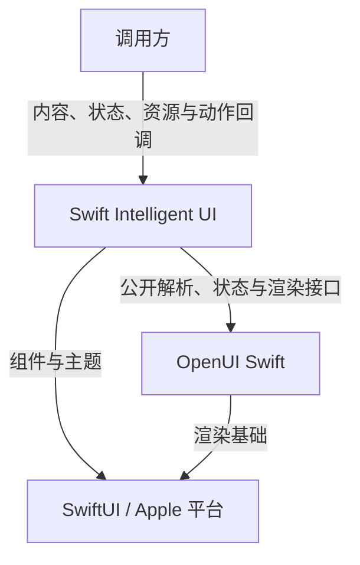

# Swift Intelligent UI 设计

本文描述当前代码的架构、组件契约、视觉原则、状态与资源、生成及交付方式。版本迭代、实屏证据、失败试验与撤回提案保存在 `swift-intelligent-ui-history.md`，不在这里展开。

## 1. 定位与边界

Swift Intelligent UI 是基于 OpenUI Swift 的 Apple 平台组件库，提供 Design System、组件、交互绑定和生成规范。布局、文字、图片、输入、商品、交通和图表遵循同一套组件机制。卡片由本库原生实现，与其他内容统一使用本库视觉系统。

调用方持有 OpenUIState、提供内容与资源、接收动作事件。库通过 OpenUI Swift 的公开接口复用解析、求值、状态、流式与渲染遍历。模型生成验证仅位于 Benchmarks。

库不负责模型服务、业务资料检索、消息生命周期、订单交易或购买结果。模型、工具和宿主提供事实；组件按来源呈现，不补造价格、库存、坐标、路线、来源或执行结果。



### 依赖与基线

- 最低平台为 iOS 16 / macOS 13。
- OpenUI Swift 固定远程 `335f99b90e62306d399343c98ad67f363f13c771`（rc.9）。依赖只能是可复现的远程固定版本，不使用本机 SDK 路径或未提交工作区。
- 组件及计算参考固定为 `16ef26475999e3a021a50b1607a03717c0721255`，不是 OpenUI 运行时内置的 82 组件 ReferenceCatalog。
- swift-markdown-ui 2.4.1，Zod 4.6.7，KaTeX 0.16.47。
- manifest 工作版本为 `0.1.0-preview.26-rc9`，尚未形成对应交付包。
- macOS 构建与 iOS Simulator Gallery 构建通过；118 项 SDK 测试有 3 项未通过，均为流式行为与既有校验的兼容性差异，详见第 8 节。

## 2. 目录与职责

统一库模块为 `SwiftIntelligentUI`，内部按职责和 UI 能力分类。

```text
open-intelligent-ui-swift/
├── Package.swift
├── Package.resolved
├── THIRD-PARTY-NOTICES.txt
├── Sources/SwiftIntelligentUI/
│   ├── IntelligentUIView.swift
│   ├── Catalog/                 # 组件注册与契约辅助
│   ├── DesignSystem/            # 系统语义色、字体、间距和形状
│   ├── Components/
│   │   ├── Layout/
│   │   ├── Content/
│   │   ├── Controls/
│   │   ├── Media/
│   │   └── DataDisplay/
│   ├── Functions/               # 固定计算代码的受控桥接
│   ├── Generation/              # spec、Prompt 与 manifest
│   └── Resources/               # 计算、公式与许可资源
├── Tests/SwiftIntelligentUITests/
├── Examples/Gallery/
│   ├── GalleryApp.swift         # iOS/macOS 共用固定案例
│   ├── Resources/               # 仅 Gallery 使用的来源照片
│   └── IntelligentUIGallery.xcodeproj/
├── Tools/
│   ├── ContractExport/
│   ├── Functions/               # 固定上游计算源码与生成工具
│   └── package.py
├── Benchmarks/
├── docs/
│   ├── swift-intelligent-ui-design.md
│   └── swift-intelligent-ui-history.md
└── outputs/                     # 本地导出、验收证据与交付包
```

组件定义与实现相邻，复杂组件在自己的文件或子目录内维护辅助类型。Catalog 聚合实际实现，Generation 读取同一个注册库。商品卡在 DataDisplay 中按普通组件维护。

SwiftPM 的 Sources/Tests 目录按 target 命名；库、Gallery、导出工具和测试分别建立 target。消费者引入库产品时，不依赖 Gallery 或开发工具。

## 3. 组件与契约

实现覆盖固定上游的 55 个组件入口，并增加本库的内容与交通展示组件。默认注册 60 个组件：54 个上游入口与本库 ProductCard、TransportCard、ImageText、Citation、Disclosure、Progress；注入图片搜索服务后注册 SearchImage，总计 61 个。数量表示入口覆盖，具体参数和平台行为以导出的 spec、manifest 为准。

| 分类 | 组件 |
|---|---|
| Layout | Col、Row、Box、Grid、Card、Carousel、Popover、Divider、Spacer、Form、Disclosure |
| Content | Text、Title、Caption、Label、Badge、Link、List、ListItem、Markdown、Quote、Code、Flashcard、Celebration、ImageText、Citation |
| Controls | Button、IconButton、Pressable、Input、TextArea、Select、SegmentedControl、RadioGroup、Slider、Checkbox、DatePicker、Timer |
| Media | Image、Icon、SearchImage、Math、Map、MapMarker、YouTube、HtmlView、Svg、Circle、Ellipse、Rect、Line、Path、Polyline、Polygon、G、SvgText |
| DataDisplay | Table、Chart、ProductCard、TransportCard、Progress |

每个组件记录有序参数、类型、默认行为、绑定与限制。渲染和生成规范使用同一份注册定义。未配置的 SearchImage 不进入默认模型规范。

### 3.1 布局与排版

- 长度使用 Apple point；Box 和 Svg 的尺寸接受数值，不解释任意 CSS 长度。颜色使用语义 token；SVG 接受经过检查的颜色字符串。图标使用明确枚举的 Lucide 名称到 SF Symbols 映射。
- Col/Box 未指定 gap 时使用阅读流间距：页面章节 24、嵌套组 12、标题与正文 8、眉题与标题 4；显式 gap 覆盖默认关系。Box 的 wrap 用于 row 方向，flex 用于非换行 Row；列方向按原生纵向布局处理。
- Row 支持逐项换行、对齐和剩余空间分配。双项图文行按照媒体在左/右的子节点顺序布局，普通内容使用主题缩略图；大字号可重排为纵向。
- Grid 的自适应列数不超过 columns，子 Col 使用紧凑内容层级；无障碍大字号下使用单列。
- Card 表示真实对象或连贯分组，不为每个段落增加表面。使用画布背景、连续圆角与轻边框；iOS 默认 16 点内边距，macOS 20 点，嵌套 16 点。嵌套内容沿用阅读层级，不重复包装 ProductCard/TransportCard 自己的表面。
- Carousel 使用可用宽度收敛卡宽、等高排列；默认首选卡宽 288 点，正常字号不超过视口的 85%。iOS 17/macOS 14 起使用原生卡片停靠，旧系统保留原生横向滚动；桌面提供上一项/下一项按钮。大字号使用可用宽度，保留可访问的前后操作。
- Divider、Spacer 分别负责分隔与剩余空间，不增加额外交互。

### 3.2 文本、列表与内容

- Text 支持内联 Markdown 和混排组件；TextKit 负责换行，嵌入 SwiftUI 视图占用附件字形，使链接、引用、标签或公式能跟随末行续排。maxLines 作用于文字段。单纯字符串仍可使用 SwiftUI Text。
- Title、Caption 支持行内 Markdown 和链接；标题读取容器上下文，Caption 靠近所属图片或内容，不自动变成独立来源区块。
- Label、Badge 表示字段标签与静态事实。Badge 的 info 为中性，状态背景为浅色；Link 使用正文继承色、下划线和行内尺寸，通过宿主动作打开原 URL。
- List/ListItem 支持 bullet、数字圆标、自定义短步骤标、时间标记列及连线。none 且无时间标记时不绘制悬空线；description 是次级摘要，主要阅读内容放 children。稳定 id 用于切换、筛选和重排时的逻辑身份。
- Markdown 提供完整文档块排版；Quote 使用浅底、内边距与侧线。Code 与 Markdown 代码块共用原文、着色和复制操作。
- Citation 在混排段落中使用紧凑内联尺寸，不把完整按钮触达高度带入正文行；独立来源块和多来源 Popover 保留完整触达与导航能力。图片署名和来源可在同一小段 Text 中组合，不额外添加重复的图片链接。

### 3.3 控件、输入与选择

- Button、IconButton、Pressable 使用原生按钮语义、胶囊/圆形/轻量表面及选中提示；没有动作时禁用，不自动发送助手消息。Pressable 和 Popover 的触发内容用于展示，避免嵌套交互控件。
- 输入绑定到显式变量，字面量只读。数值草稿保留中间输入，空值写入 null，无效草稿不覆盖上一有效值。数字字段使用适合数字与标点的原生键盘。
- Input 和 TextArea 共享 FieldSurface，使用原生编辑控件、统一边框、内边距、焦点与错误状态。Input/Select 使用胶囊形字段，TextArea 使用连续 18 点圆角；边框为主题 fieldBorder 的固定 1 点描边。
- Select 和选择组使用首个同值选项，未知值保持未选择。短选项使用原生分段 Picker，窄屏或大字号时重排。RadioGroup pills 使用胶囊互斥选择，cards 使用说明型自适应选项；普通单选可用圆形指示与字重表达，不强制所有控件绘成同一种胶囊。
- Slider 使用原生滑杆，保留标签、当前数值和 marks。Checkbox 保留勾选框与整行触达。DatePicker 使用 Gregorian 日历日期，严格校验 YYYY-MM-DD。
- Timer 按经过的时间递减，支持开始、暂停、重置，离开界面暂停。Flashcard 整卡切换正反面；Celebration 在 false→true 时短暂展示装饰，减少动态效果时关闭，不显示固定成功文案。
- Form 的可选 status 为 idle/submitting/success/error，message 为调用方提供的结果。提交中禁用内部字段与操作，结果不由库推断；Input、TextArea、Select 的 error 参数呈现统一字段错误。

### 3.4 数据、图表与表格

- Table 保持 columns/rows 接口，按内容与容器计算列宽：描述列弹性伸展，金额/数字列保留内容宽并右对齐；少列填满，多列或过长最小宽度才横滑。保留单元格留白、表头层级、等行高顶部多行对齐和细行分隔。
- Table 按行顺序保持 UI 身份，数字列使用等宽数字；无障碍大字号下改为带字段名的纵向条目。
- Chart 提供柱、线、面积、散点、饼和环形。缺失数字不补成零。支持点选、横向拖动和悬停探查，selected 可绑定所选类别；数值通过锚定 Popover 展示，也保留可访问的数值入口。
- 饼/环形可点选扇区。完整数据可展开核对，大字号直接呈现数据明细；不把常驻辅助选择器当作图表的必需视觉元素。

### 3.5 地图与平台桥接

- Map 使用 MapKit 与 SDK 摘要卡：内嵌默认 360 点，主题范围 300–400 点，大字号 400 点，不随内容增长。完整详情按任务放地图外，不请求用户位置。
- content 可复用 Card、ImageText、Carousel 等组件；图内摘要使用固定方图、名称和辅助信息，完整正文或来源 footer 不应挤入摘要形态。基础卡不编造照片。
- Map 与 Carousel 通过稳定地点 id/selected 联动，卡片内可横滑切换。visibleIds 为 string[] 或 null：null 表示未筛选，[] 隐藏全部点位；字面量数组只读，未绑定时可使用本地过滤。
- 内建前后切换、筛选、fit-all 与展开/关闭。筛选同时约束点位、卡片、选中状态和 fit 范围；卡片 itemIds 必须与 marker id 对应。route 是坐标直线示意，routeIds 表示已提供的访问顺序，不计算道路路线，也不把全部备选连成行程。
- Math 使用固定 KaTeX 在本地生成 MathML，由 WebKit 排版；SVG 使用脚本关闭的本地 WebKit。它们属于明确的平台桥接。
- HtmlView 使用独立非持久 WebKit，没有原生消息桥。仅完整内容开始运行，允许内联脚本，限制网络及导航；默认高度 360 point，可内部滚动。切换外观不重载页面状态。
- YouTube 使用隐私增强播放器，需要网络与用户播放操作，保持响应式媒体容器。无效地址显示错误。

### 3.6 基础组件对齐与扩展边界

固定上游组件语义是基础，Apple 原生适配包括 Dynamic Type、系统控件、可读重排、原生滚动、可访问操作和 WebKit 隔离，不意味着逐像素复制 CSS。

扩展组件与参数保持既有兼容：Carousel 增加 selected/itemIds，Chart 增加 selected，Image 增加 preview，Input/TextArea/Select 增加 error，Form 增加 status/message，ListItem 增加 id，HtmlView 增加 title；MapMarker 增加 id/badge，Map 增加 content/expandable/visibleIds/routeIds。新增可选参数追加在原参数后，旧短调用继续有效。

状态颜色按用途解析：info/success/warning/danger/purple/pink 作为 Box/Pressable 背景使用浅色，文字保留前景色；chart 颜色仍是明确绘图颜色。诊断不应把同名状态前景与浅背景误判为相同绘制颜色。

## 4. Apple 原生视觉与行为

整体采用接近 ChatGPT 内容表达的杂志式排版，以正文、图片、留白和信息层级建立阅读顺序；字体、控件和交互遵循 Apple 平台习惯。

- **字体层级**：使用 Apple 默认系统字族与 Dynamic Type，不指定衬线或圆体作为阅读字体。正文与辅助文字保持 regular，常规标题和短语强调默认 medium，最大展示标题与价格/交通时间保留 semibold。Title、Text、Caption、List、Table、混排 TextKit 与 Markdown 共用主题的强调字重，Markdown 标题不隐式升级为 bold。代码保留等宽字体，计时器保留数字展示字体。中文、英文与金额自然换行。
- **阅读节奏**：开篇眉题紧接标题，标题靠近正文，连续段落保持阅读间距，图注靠近图片，章节之间增加留白。正文到随后图片使用组间距，图片/图表/表格/SVG 后的 Caption 使用较小内间距；显式 gap 仍由调用方决定。
- **统一 token**：正文行距、段落间距、章节间距、内间距、价格字体、商品图片比例、阅读行宽与主操作前景/背景均由 IntelligentUITheme 提供。卡片使用 contentCardRadius、nestedContentCardRadius、optionCardRadius 等集中 token，模型不另增视觉参数。
- **操作层级**：主按钮采用统一的黑白动态配色，使用 borderedProminent；商品卡购买操作使用按文案宽度呈现的紧凑黑白主按钮；次操作使用 bordered 或轻量描边，低强调操作使用 borderless。正文中明确需要的链接保持次级样式。短选择优先原生 segmented Picker。
- **平台密度**：iOS 和 macOS 采用不同的控件高度初值；间距与圆角是项目 token，不宣称为 Apple 的统一硬性数值。iOS 的主要操作保留 44 点触达。
- **颜色与边界**：采用系统背景、分隔色、主次文字和动态外观。优先对齐、留白和轻分隔；卡片表示真实对象或分组。
- **数据表达**：Cartesian 图表使用 Swift Charts；图例、轴和明细协同表达。饼/环形以原生绘图实现并提供图例与明细。
- **导航**：Gallery 使用 NavigationSplitView、NavigationLink 和原生工具栏菜单；手机按系统规则折叠导航。SDK 不接管宿主页面导航。
- **适配**：大字号通过重排、增高和展开明细保持可读，不整体缩小内容。主要操作有可访问名称，状态同时使用文字或形状提示。
- **反馈**：绑定修改直接影响结果；动作通过 SDK 派发。加载、缺图、错误、禁用和处理中状态与真实状态对应。

通用 Image 使用 16:9 封面比例，在加载、成功和失败状态保留同一媒体区域；原图预览与 Markdown 文档插图保留完整来源比例。ProductCard 使用自己的商品媒体比例，不直接套用通用 Image 默认值。

设计依据：[Apple Design Principles](https://developer.apple.com/design/human-interface-guidelines/design-principles/)、[Fonts](https://developer.apple.com/documentation/technologyoverviews/fonts)、[Buttons](https://developer.apple.com/design/human-interface-guidelines/buttons)。具体效果以运行画面与操作验收为准。

## 5. 状态、资源与计算

### 5.1 宿主与状态

IntelligentUIView 接收外部创建的状态和匹配的 IntelligentUILibrary。makeState() 是创建正确 SDK 配置的便捷入口，状态生命周期仍由调用方持有。

最小接入在主线程完成：

```swift
let library = try IntelligentUILibrary()
let state = library.makeState()
state.onAction = { event in
    // 调用方处理动作。
}
state.setSource(#"root = Col([Title("原生界面"), Text("可组合的内容")])"#)
let view = IntelligentUIView(state: state, library: library)
```

调用方应长期持有 state，例如放入 StateObject 或自己的展示模型，避免在 body 中反复创建。公开别名 IntelligentUIState 和 IntelligentUIActionEvent 让宿主无需直接使用 OpenUI 的类型名称。

同一状态实例支持完整输入、流式追加、绑定和派生计算。组件使用 SDK 上下文检查交互就绪和旧回调失效，不重复实现运行时。默认内容宽度由 IntelligentUIView 读取 theme.readingWidth，接入方可通过同一主题调整。

库区分两个目录：

| 目录 | 职责 |
|---|---|
| readerComponents | 渲染既有消息，保留完整组件与历史字段兼容 |
| components | 生成 spec、Prompt 与 manifest；可通过 excludingComponents 排除宿主不支持的组件 |

Host 的组件排除只缩小新输出契约，不删除旧消息读取能力。ImageSearch 只有显式服务才注册。图片资源可由 `.intelligentUIImages([source: Image])` 精确提供；阅读位置接口施加在宿主自己的纵向滚动容器，不替宿主管理页面。

### 5.2 函数与动作

59 个扩展函数复用固定上游的计算实现，通过 JavaScriptCore 执行。仅运行随包固定代码，输入按 JSON 数据传递；OpenUI 的解析和求值继续由 SDK 提供。桥接限制输入大小与嵌套深度，异常返回 null。原生组件和动作值不作为这些计算函数的数据输入。

函数参数来自固定上游生成规范，计算源码经过 Git blob 校验；每个扩展函数都有 golden case。时间测试可以注入 referenceDate，随机函数验证类型与边界。资源中保留上游、Zod 和 KaTeX 许可。

扩展动作 CopyToClipboard 以及 SDK 的 Set、OpenUrl、ToAssistant 交给调用方处理。相对链接保持原值，组件不自行进行交易。OpenUrl 只负责导航，不代表购买、库存确认或预订成功。

### 5.3 图片与内容资源

Image、ProductCard 与 SearchImage 共用图片状态视觉：等待时在固定媒体区显示循环扫光骨架与无文字进度指示；失败或缺图时只显示低强调图形占位，不显示可见状态文案。远程加载失败与图片搜索失败都保留带无障碍名称的重试图标。

解码图片由共享 ImagePipeline 缓存，最多 40 张、64 MiB 成本上限；相同 URL/目标尺寸的并发请求合并，图像最长边默认下采样到 1600 像素，拒绝非成功 HTTP 响应和超过 20 MiB 的响应体。切换来源后不写入已失效视图任务的结果。状态说明供辅助技术朗读，减少动态效果时停用扫光。

商品图与搜索结果图可点开原比例大图，支持缩放按钮、双击、捏合与滚动，关闭后回到原内容。Grid/Carousel 从原始 Image 节点归集同组照片，可在大图中前后浏览，不显示数字分页。通用 Image 默认允许预览，可通过 preview=false 关闭；Pressable、Popover 触发器和 Flashcard 内抑制嵌套预览按钮。大图查看不执行外部业务动作。

Code 与 Markdown 代码块共用着色和复制操作：Swift、JS/TS、Python、JSON 与 shell 使用轻量词法着色，未知语言或超过 200 KB 的内容保留纯文本。复制派发原始 CopyToClipboard 事件，宿主负责系统剪贴板写入；事件发送不等于未知宿主复制成功。

## 6. 商品与交通组件

### 6.1 ProductCard

ProductCard 接受一个 product 对象和 layout，每张卡对应一个商品或可预订服务，价格与购买地址直接属于该对象。

- 必填：id、title、images；图片项包含 url、alt。
- 价格：price 为来源非负金额，可配合 ISO currency 或货币/金额字符串；priceNote 保存单位、条件和范围说明。priceText 仅用于历史读取，不在新生成契约中推荐。
- 可选：specification、merchant、condition、availability、observedAt、purchaseURL、sourceURL、actionLabel、tags。
- 布局：vertical、horizontal 或 compact；compact 用于地图等紧凑位置，缩略图在左、内容在右。窄屏横排和无障碍大字号重排为纵向。

商品大图默认采用主题统一的 3:2 比例，horizontal/compact 缩略图保持 1:1。imageFit 默认为 cover；contain 在固定区域保留完整原图，背景由边缘低频取色并柔和过渡，不复制商品轮廓，也不承诺任意素材无缝。预览仍展示原图。

规格完整可见，condition/availability 简洁显示，不自动附加“商品详情”底栏或来源入口。主金额与动作优先同一行，空间不足时可读回退，不缩字或截掉主金额。缺少有效购买地址时没有购买操作，未知价格明确显示，未提供的可选信息不补占位文案。

多个商品直接组合 Carousel 或 Grid。每个商品的身份、图片、价格和购买地址各自独立，多图保留切换与可访问名称。Gallery 使用有来源与许可的演示照片，演示价格与购买路径不属于库产品。

### 6.2 TransportCard

TransportCard 展示调用方提供的本地日期、时间、时区、行程段与票价文本，不根据本地时钟推断经过时间，不凭段数推断中转、联程、通票或总价。

一张卡对应一个来源 journey/方向，legs 只取该 journey 的有序 segments。独立 journeys、去返和备选不能拍平为连接段。只有全部相应段间均有显式 connections 时才显示中转次数；父级报价范围不明时在外围原样展示一次，不复制到每张方向卡或擅自拆价。

商品与交通共用主链接按钮和动作派发链，不另造 Action 视觉组件。

### 6.3 地图组合

```text
MapMarker(id=a) ── $selected ── Carousel(itemIds=[a,b])
MapMarker(id=b)                 ├── ProductCard(a, compact)
                               └── ProductCard(b, compact)
```

模型从同一份来源数组派生 marker、图内/图外卡片和 itemIds，不分别手写多份业务数据。共享 selected 与 visibleIds 是明确绑定，不要求宿主采用 places、hotels 等固定变量名，也不新增全局实体目录或跨来源匹配协议。

## 7. 生成、运行与交付

```text
实际注册契约 + 当前能力配置 + 组合规则
                ↓
      spec.json / prompt.txt / manifest.json
```

在项目根目录运行：

```sh
swift test
swift run IntelligentUIGallery
swift run ContractExport outputs/contracts
python3 Tools/package.py
```

iOS Gallery 工程为 `Examples/Gallery/IntelligentUIGallery.xcodeproj`，scheme 为 IntelligentUIGallery；支持 iPhone/iPad，引用本包与固定远程 SDK revision。消费者不需要 Gallery 或开发工具。

Agent 契约位于 `outputs/contracts/prompt.txt`，由 `library.systemPrompt` 直接导出。它包含语法、60 个默认组件的签名与行为、内置及注册函数、动作、视觉与事实约束，以及同日记录、稳定任务、消费确认、基础图文、已知联程、独立去返、地图联动与表单计算八个完整示例。示例数据与链接仅用于解释语法，不作为真实推荐。

生成原则：

1. 输出纯 openui-lang，不添加 Markdown fence；宿主若用 JSON program 字段包装，应在传输层解包。
2. 使用已注册组件、位置参数与显式状态；派生数据放普通变量，状态默认值使用字面量。
3. 保留来源字段名、事实、原始 URL、实体 id、价格范围和不确定性，不将解析成功当作事实正确。
4. 用 Col/Row/Grid/Box/Text/Image/Carousel 组合普通内容；卡片只表达真实对象或分组，不生成页面模板。
5. 图片由布局负责尺寸与比例，新生成使用 Image(src, alt)，默认封面为 16:9；有署名时在相邻紧凑 Text 中保留来源和 Citation。
6. 交互控件必须有明确动作或状态结果，不生成装饰性按钮、虚构进度或无来源表单反馈。
7. 不依赖流式中间帧的固定显示顺序；当前 rc.9 使用上游默认发布行为。

导出验证器接受 Lang 文件或包含 program 字段的 JSON：

```sh
swift run ContractExport --validate path/to/program.lang
```

`sourceIssues(in:)` 检查源码标识符等问题；`validationIssues(in:source:)` 汇总源码、运行时、组件与 Map 数据关系问题；`validationIssues(in:)` 检查求值树；`presentationWarnings(in:)` 提供非阻断的语义颜色提示，不是实测对比度审计。诊断不替代事实审查或真实 UI 验收。

模型验证使用 `python3 Benchmarks/run.py --model gpt-6.1-terra`，按用户确认使用该模型。保存请求、原始输出、解析与运行时结果，不静默换型。未经人工改写的模型程序保存在 Benchmarks/Recorded，不能与固定 Gallery 案例的视觉验收混用。

本地交付包含源码、锁定依赖、测试、Gallery、工具、当前设计、历史档案与生成契约。SHA256SUMS 与按版本保存的 source-manifest 记录归档及逐文件校验和，旧预览包保留。交付不包含账户配置或运行日志，也不执行远程发布。`Tools/package.py` 中的交付版本必须与 manifest 一致，当前 rc.9 工作版本尚未封包。

CLI 的导出、--validate 与 --case 参数及返回结构保持稳定。Input、TextArea、Select、Form、Chart、Image 的新参数均可选并追加在原参数之后，旧短调用有回归检查。早期 ProductCard 的 offers 已删除，旧商品数据使用直接价格与购买地址字段，不另做旧模型适配。

## 8. 验证边界与流式现状

| 层次 | 验证职责 |
|---|---|
| 构建 | macOS Swift Package 与 iOS Simulator Gallery，证明目标平台可编译 |
| 自动测试 | 计算函数、解析、绑定、流式、图片、字段、布局与组件数据；失败必须保留并解释 |
| 契约 | spec、Prompt、manifest 与真实组件库一致，包含 60 个组件、59 个函数 |
| Gallery | 固定程序的 UI 演示和离线检查，不代替真实模型输出或真实操作 |
| 真实界面 | 指定设备、原程序与原图片的实际显示和操作，不能由编译或单元测试推断 |

当前 OpenUI rc.9 不包含此前使用的 orderedRendering，makeState() 使用上游默认创建方式，未启用任何本地候选或补丁。由此产生三项未解决的兼容性问题：

- 后生成的兄弟内容可能先于尚未就绪的前序区块显示，不能假设中间帧按源码顺序只追加。
- 未选中的条件分支也可能影响 isSourceComplete 和 SDK 诊断，导致误报未完成内容。
- 尚未闭合的根组件可能使其中的完整按钮暂时无法取得。

现有测试如实保留这些失败；契约不再要求模型依赖“有序就绪前缀”。这三项是当前基线的限制，不是已接受的流式体验保证。正式交付前应明确修复、调整或接受的范围，而不是仅更新版本号。

自动检查通过不等于所有设备、全部模型任务或所有流式时序已接受。外部视频、完整 VoiceOver 听读、真实业务动作和物理设备覆盖需要独立验证。

## 9. 设计约束

1. **通用机制优先**：先用固定组件、变量、绑定、Each 和基础布局证明缺口，再讨论新接口；不新增全局业务数据归一层。
2. **依赖可复现**：OpenUI 只使用远程固定 revision，不能引用本机路径或未提交工作区。
3. **显示与业务解耦**：Map 等容器对通用组件的样式调整应有明确边界，优先显式样式组合，不通过环境隐式改变业务语义。
4. **结构错误可见**：Map 内容投影的隐式回退应受约束，校验与实际渲染保持同一结构规则，避免错误配置静默替换为摘要卡。
5. **契约单一来源**：逐步由 writer schema 生成 Prompt，减少字符串正则补丁；历史 reader 兼容与新 writer 校验分别说明。
6. **文档面向当前**：本文保留完整设计与实际限制，版本过程继续按时间顺序追加到历史档案，不回写历史结论。
