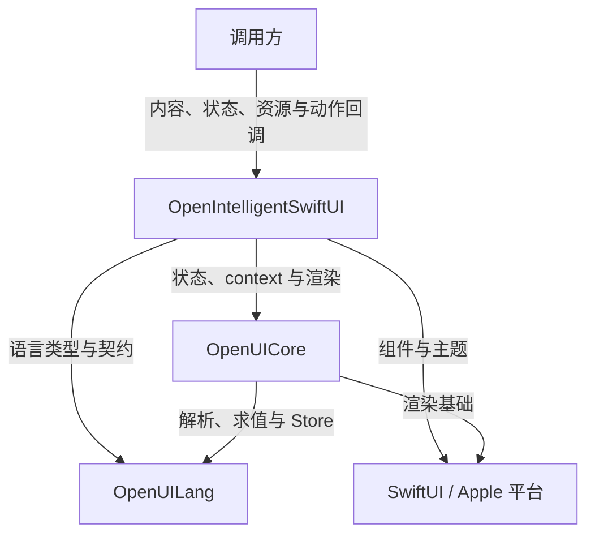

# Swift Intelligent UI 设计

本文描述 `OpenIntelligentSwiftUI` 的组件契约、视觉规则、状态与资源、生成及交付方式，以及后续迭代必须遵守的边界。跨模块所有权与共享运行时以[四模块架构](architecture.md)为准；接入与修改规则概览见 [README](../README.md)。

## 1. 定位与基线

`OpenIntelligentSwiftUI` 是基于 `OpenUILang` 与 `OpenUICore` 的 Apple 平台组件库，提供 DesignSystem、组件、交互绑定和生成规范。布局、文字、图片、输入、商品、交通和图表遵循同一套组件机制。

调用方持有 Core 定义的 `OpenUIState`、提供内容与资源、接收动作事件。库通过 Lang 的解析与求值接口和 Core 的状态、流式、context/host 与渲染遍历复用运行机制。模型生成验证仅位于 Benchmarks。

库不负责模型服务、业务资料检索、消息生命周期、订单交易或购买结果。模型、工具和宿主提供事实；组件按来源呈现，不补造价格、库存、坐标、路线、来源或执行结果。



### 依赖与边界

- 最低平台为 iOS 16 / macOS 13。
- 四个模块在根 `Sources/`、`Tests/` 中共同版本化，根包导出 `OpenUILang`、`OpenUICore`、`OpenSwiftUI` 与 `OpenIntelligentSwiftUI`。通用底座的首次导入来源为 `zyfn/openui@f3dfa1d0b479c131b6d4268e81961186f22ff09c`。开发工具、验证器、规范夹具与示例分别在根 `Tools/`、`Validation/`、`Fixtures/`、`Examples/` 维护，来源与原始许可保存在 [Provenance/OpenUI](../Provenance/OpenUI/README.md)。上游语言核心通过固定官方源码的构建期依赖生成，保留显式原生适配；运行时不下载脚本。当前边界见[四模块架构](architecture.md)。
- 组件及计算参考固定为 `16ef26475999e3a021a50b1607a03717c0721255` 的 55 组件库，不是 OpenUI 运行时内置的 ReferenceCatalog。
- swift-markdown-ui 2.4.1，Zod 4.6.7，KaTeX 0.18.2；依赖安全修复与资源来源见[验证与安全修复](validation-and-security.md)。

## 2. 模块与目录

四个库产品由同一个根 `Package.swift` 构建。`OpenSwiftUI` 与 `OpenIntelligentSwiftUI` 是各自独立的 UI 库，都直接依赖 `OpenUICore` 和 `OpenUILang`，彼此没有依赖；共享运行时状态与机制，分别维护组件契约和视觉规则。

| 模块 | 源码与测试 | 职责 |
|---|---|---|
| `OpenUILang` | `Sources/OpenUILang`、`Tests/OpenUILangTests` | 语言桥接、解析与求值、Store、动作与查询语义、序列化与预算 |
| `OpenUICore` | `Sources/OpenUICore`、`Tests/OpenUICoreTests` | state/session、组件注册、context/host、递归渲染与身份、绑定、生命周期及通用资源机制 |
| `OpenSwiftUI` | `Sources/OpenSwiftUI`、`Tests/OpenSwiftUITests` | 标准目录、主题、布局就绪与占位策略、标准组件和媒体视觉 |
| `OpenIntelligentSwiftUI` | `Sources/OpenIntelligentSwiftUI`、`Tests/OpenIntelligentSwiftUITests` | Intelligent UI 目录、设计系统、交互与媒体呈现、计算及 reader/writer 生成契约 |

`OpenIntelligentSwiftUI` 内部按职责和 UI 能力分类：

| 目录或入口 | 职责 |
|---|---|
| `Library.swift` | 为共享 `OpenUILibrary` 提供 `.intelligent(...)` 工厂，配对 writer、历史 reader 与本库视图 |
| `IntelligentUIView.swift` | 实现本库外观与阅读宽度，由统一入口组合共享 Core renderer |
| `Catalog/` | 组件注册、状态工厂与参数读取 |
| `DesignSystem/` | IntelligentUITheme、EditorialStyle、阅读位置规则 |
| `Internal/` | 本地化、性能与布局调试辅助 |
| `Components/Layout/`、`Content/`、`Controls/`、`Media/`、`DataDisplay/` | 对应能力的组件定义与原生实现 |
| `Functions/` | 固定计算代码的受控桥接 |
| `Generation/` | spec、Prompt、manifest 与诊断 |
| `Resources/` | 计算、公式、本地化与许可资源 |

根 `Examples/` 维护 Gallery、macOS 消费示例和 Agent 契约案例；`Tools/` 维护生成器与检查工具，`Fixtures/` 维护版本化语言规范夹具，`Validation/` 维护独立验证器及冻结源码修复清单。`Benchmarks/`、`docs/` 分别维护模型验证和文档，`outputs/` 保存本地导出与验收材料。原始导入记录与许可集中在 `Provenance/OpenUI/`，不构成第二个 SDK 包。

组件定义与实现相邻，复杂组件在自己的文件或子目录维护辅助类型。Catalog 聚合实际实现，Generation 读取同一个注册库。消费者只需链接 `OpenIntelligentSwiftUI` 产品及其传递依赖，不依赖标准 UI 库、Gallery 或开发工具。

## 3. 宿主接入与状态

宿主通过 Core 的 `OpenUILibrary` 和 `OpenUIView` 接入，选择 `.intelligent(...)` 即配对本库的生成契约、历史读取契约与视觉实现。`makeState(...)` 创建使用该库 schema 和实际函数实现的 `OpenUIState`，状态生命周期仍由调用方持有。

最小接入在主线程完成：

```swift
import OpenIntelligentSwiftUI

let library: OpenUILibrary = try .intelligent()
let state = library.makeState()
state.onAction = { event in
    // 调用方处理动作。
}
state.setSource(#"root = Col([Title("原生界面"), Text("可组合的内容")])"#)
let view = OpenUIView(state: state, library: library)
```

调用方应长期持有 state，例如放入 StateObject 或自己的展示模型，避免在 body 中反复创建。`library.systemPrompt` 和 `library.specificationJSON` 提供模型生成契约；宿主使用同一个 Core 状态与事件类型切换标准库或 Intelligent 库。

同一状态实例支持完整输入、流式追加、绑定和派生计算。组件使用 SDK 上下文检查交互就绪和旧回调失效，不重复实现运行时。统一入口内部由 `IntelligentUIView` 应用本库主题与 `theme.readingWidth`，接入方可通过同一主题调整。

运行时中，重复传入相同的已完成源码不会重建展示或清空用户状态，空的 push 也不启动新流。宿主需要重新播放同一程序时，应显式 reset() 后再 setSource；真正替换内容或 reset 后，原展示的回调与绑定失效。

库区分两个目录：

| 目录 | 职责 |
|---|---|
| readerComponents / readerSpecification | 渲染既有消息，保留完整组件、参数顺序、绑定、枚举、默认值与历史字段 |
| components / specification | 从 reader 定义结构化投影 writer，生成 spec、Prompt 与 manifest；可通过 excludingComponents 排除宿主不支持的组件 |

Host 的组件排除只缩小新输出契约，不删除旧消息读取能力。SearchImage 只有显式服务才注册。宿主在 `OpenUIView` 上使用 `.openUIResourceContext(resources)` 注入原生图片加载所需的资源解析、鉴权和预算；内联原生附件与图片预览继承同一作用域。`.intelligentUIImages([source: Image])` 继续支持精确的 SwiftUI 图片覆盖。阅读位置接口施加在宿主自己的纵向滚动容器，不替宿主管理页面。

## 4. 组件与契约

默认注册 60 个组件：54 个上游入口与本库 ProductCard、TransportCard、ImageText、Citation、Disclosure、Progress；注入图片搜索服务后注册 SearchImage，总计 61 个。具体参数和平台行为以导出的 spec、manifest 为准。

| 分类 | 组件 |
|---|---|
| Layout | Col、Row、Box、Grid、Card、Carousel、Popover、Divider、Spacer、Form、Disclosure |
| Content | Text、Title、Caption、Label、Badge、Link、List、ListItem、Markdown、Quote、Code、Flashcard、Celebration、ImageText、Citation |
| Controls | Button、IconButton、Pressable、Input、TextArea、Select、SegmentedControl、RadioGroup、Slider、Checkbox、DatePicker、Timer |
| Media | Image、Icon、SearchImage、Math、Map、MapMarker、YouTube、HtmlView、Svg、Circle、Ellipse、Rect、Line、Path、Polyline、Polygon、G、SvgText |
| DataDisplay | Table、Chart、ProductCard、TransportCard、Progress |

每个组件记录有序参数、类型、默认行为、绑定与限制。writer 复用原有 renderer，只投影既有生成规则已经限制的字段：Image 新输出使用 src/alt，SearchImage 使用 query，商品与交通新输出不用 priceText。完整历史 reader 保留这些字段。其余组件及六个新增入口均保持现有签名；原生增强由 SDK 内部或 Swift 宿主配置负责，不要求模型学习额外方言。

### 4.1 布局与排版

- 长度使用 Apple point；Box 和 Svg 的尺寸接受数值，不解释任意 CSS 长度。颜色使用语义 token；SVG 接受经过检查的颜色字符串。图标使用明确枚举的 Lucide 名称到 SF Symbols 映射。
- Col/Box 未指定 gap 时按阅读关系取 token：章节、连续正文、标题与正文、眉题与标题、媒体与图注分别处理；透明单子包装不破坏关系。显式 gap 只覆盖间距，不改变后代阅读层级。Box 的 wrap 用于 row 方向，flex 用于非换行 Row；Spacer 的权重与布局轴一致。
- Row 支持逐项换行、对齐和剩余空间分配。默认图文规则仅用于可识别的双项媒体/正文关系；显式尺寸、gap、align、justify、wrap 优先。切换窄屏、大字号或 RTL 时复用内容身份。
- Grid 保留 columns 默认 2 的原有含义；提供 minChildWidth 时才按宽度减少列数，且不超过 columns。无障碍大字号使用单列。生成规则应为需要适应窄屏的内容选择现有 minChildWidth 参数。
- Card 表示真实对象或连贯分组，不为每个段落增加表面。使用画布背景、连续圆角与轻边框；iOS 默认 16 点内边距，macOS 20 点，嵌套 16 点。嵌套内容沿用阅读层级，不重复包装 ProductCard/TransportCard 自己的表面。
- Card 不根据子项位置把普通 Text 改成标题或副标题；未显式指定的排版可以使用上下文默认值，显式字号始终优先。
- Carousel 使用可用宽度收敛卡宽；默认首选卡宽 240 点，正常字号不超过视口的 85%。同类实体卡保留可比较的高度，普通内容按自然高度显示；横滑容器总体仍由最高内容决定。末尾补足停靠空间，使最后一项可与当前索引一致。iOS 17/macOS 14 起使用原生停靠，旧系统同步偏移位置；桌面和无障碍提供前后操作。子项使用 child.id，方向按宿主 RTL 环境处理。
- Divider、Spacer 分别负责分隔与剩余空间，不增加额外交互。

### 4.2 文本、列表与内容

- Text 支持内联 Markdown 和混排组件；字符串与 TextKit 共享字号角色、字重和行距决策。附件按 child.id 保留原生 host，Markdown 解析、同宽测量与附件适配分别缓存；异步尺寸变化使测量失效。maxLines 截断后不可见附件不能继续接受操作。桥接转发 locale、方向、字号、对比度、displayScale 及图片环境。
- Title、Caption 支持行内 Markdown 和链接；标题读取容器上下文，Caption 靠近所属图片或内容，不自动变成独立来源区块。
- Label、Badge 表示字段标签与静态事实。Badge 的 info 为中性，状态背景为浅色；Link 使用正文继承色、下划线和行内尺寸，通过宿主动作打开原 URL。
- List/ListItem 支持 bullet、数字圆标、自定义短步骤标、时间标记列及连线。none 且无时间标记时不绘制悬空线；description 是次级摘要，主要阅读内容放 children。节点身份由运行时维护，不追加私有 id 参数。
- Markdown 提供完整文档块排版；Quote 的浅底、圆角、侧线和内边距使用同一表面。Code 与 Markdown 代码块共用原文、着色和复制操作；长代码先显示有界预览，可展开，复制始终派发完整原文。
- Citation 在混排段落中使用紧凑内联尺寸，不把完整按钮触达高度带入正文行；独立来源块和多来源 Popover 保留完整触达与导航能力。图片署名和来源可在同一小段 Text 中组合，不额外添加重复的图片链接。

### 4.3 控件、输入与选择

- Button、IconButton、Pressable 使用原生按钮语义、胶囊/圆形/轻量表面及选中提示；没有动作时禁用，不自动发送助手消息。Pressable 和 Popover 的触发内容用于展示，避免嵌套交互控件。
- 输入绑定到显式变量，字面量只读。数值草稿保留中间输入，空值写入 null；未失焦时也显示尚未生效的草稿与当前有效值，失焦后提供错误反馈与明确恢复/采用操作。外部状态更新不静默丢弃草稿，错误的逗号分组不能通过删除逗号变成另一个数字。该机制是单字段编辑状态；Form 不自动收集错误或阻止其他动作提交，宿主须按业务要求组织校验。
- Input 和 TextArea 共享 FieldSurface，使用原生编辑控件、统一边框、内边距、焦点与错误状态。Input/Select 使用胶囊形字段，TextArea 使用连续 18 点圆角；边框为主题 fieldBorder 的固定 1 点描边。
- Select 和选择组使用首个同值选项，未知值保持未选择。短选项使用原生分段 Picker，窄屏或大字号时重排。RadioGroup pills 使用胶囊互斥选择，cards 使用说明型自适应选项；普通单选可用圆形指示与字重表达，不强制所有控件绘成同一种胶囊。
- Slider 显示来源原值，越界时只将滑块投影到安全位置；实际调整或明确采用才写回。密集 marks 分行避让，保留每个标记。Checkbox 保留勾选框与整行触达。DatePicker 的空值、非法值和越界值保持未选定/错误反馈，候选日期经确认才写回；协议编解码继续使用 Gregorian、UTC、POSIX 和 YYYY-MM-DD。
- Timer 使用单调经过时间递减，取消隐式一年截值，提供运行、暂停、完成和无效状态。Flashcard 只挂载可见一面，避免隐藏媒体继续执行；Celebration 保留原有 false→true 与减少动态效果规则。
- Form 只负责字段分组和动作作用域，不追加 status/message 参数，也不自动绘制卡片边框。独立表单需要可见分组时使用 Card 包裹 Form；Box 不承担默认卡片边框，内联筛选和短操作区不强制包卡。校验、结果与进度反馈使用普通 Text 和显式状态组合，结果不由库推断。

### 4.4 数据、图表与表格

- Table 保持 columns/rows 接口，按内容与容器计算列宽：描述列弹性伸展，金额/数字列保留内容宽并右对齐；少列填满，多列或过长最小宽度才横滑。保留单元格留白、表头层级、等行高顶部多行对齐和细行分隔。
- Table 按行顺序保持 UI 身份，数字列使用等宽数字，常见缺值标记不单独改变整列数字对齐；无障碍大字号改为带字段名的纵向条目。
- Chart 提供柱、线、面积、散点、饼和环形。明细和读屏保留当前 Value/Double 可表达的精度，坐标轴可使用紧凑格式；不声称恢复来源已经丢失的小数精度。缺值保留类别并中断对应系列连线，不补零、不跨缺口连接。点选/拖动/悬停的选择只属于图表，浮层有界且保留可访问入口。
- 饼/环形按点身份选择，图例可访问全部类别；来源负值不绘制为正占比并在明细中保留。完整数据可展开核对，大字号直接呈现明细。

### 4.5 地图与平台桥接

- Map 使用 MapKit 展示调用方提供的坐标：内嵌默认 360 点，组件内部范围 300–400 点，大字号 400 点，不随内容增长，不请求用户位置。
- MapMarker 保持官方 label/lat/lng/category/icon 参数；icon 是一个 emoji，缺省时 pin 显示序号。Map.selected 保存被点击 marker 的 label，不追加私有 id。重复 label 会生成明确诊断；筛选或数据变化后，可视选择与 selected binding 同步到仍然有效的 marker。
- 地点名称常驻在 pin 下方，最多两行并限制宽度；选中使用黑色圆形高亮并提升显示层级，不默认弹出 callout 遮挡地图。
- 内联地图提供分类过滤与 fit-all，点选只更新高亮。展开导航由外层宿主呈现；height 超过 400 点时允许平移，最高 800 点，全屏地图本身不再叠加另一套控制栏。route 是坐标直线示意，按 marker 顺序连接，不计算道路路线，也不把全部备选连成行程。
- 全屏由宿主统一组合顶栏与底部横向卡片，官方 markers 和 selected 是唯一数据与选择来源。点选或横滑停稳后按统一尺度聚焦点位，选中标签保持不变；全览操作恢复首次适配的全部点位，不需要新增相机 DSL。底部卡片固定左图右文，不展示营业状态，相机按顶栏与卡片实际高度预留可见区域。
- 地点卡片、图片与详情放在 Map 外，用普通组件组合；Map 不接收 content，不投影业务卡片，也不追加 visibleIds/routeIds。视口历史由地图组件持有，原生 MapKit 视图更新或重建不会把用户刚选中的聚焦覆盖成总览。
- Math 使用固定 KaTeX 在本地生成 MathML，通过可取消的串行工作队列与有界缓存避免重复任务；未完成源内容先呈现等待状态。SVG 保持本地无内容脚本的 WebKit，整图预算限制节点、路径、点数、深度和字节；语义颜色读取主题，显式颜色保持来源指定，错误提供说明。
- HtmlView 使用独立非持久 WebKit，没有原生消息桥。仅完整内容开始运行，允许内联脚本，限制网络及导航；默认高度 360 point，可内部滚动。切换外观不重载页面状态。
- WebKit 的加载、尺寸测量和销毁按内容版本处理；旧回调不覆盖新内容，外观修改通过样式更新，宽度变化触发重新测量，失败可重试。离开时停止加载和播放。
- YouTube 使用隐私增强播放器，需要网络与用户播放操作，保持 16:9 容器；无效地址显示错误并提供可用的原始链接入口。父页面加载完成不构成外部播放器已就绪或可播放的保证，需独立进行网络与播放验收。

固定上游组件语义是基础，Apple 原生适配包括 Dynamic Type、系统控件、可读重排、原生滚动、可访问操作和 WebKit 隔离，不意味着逐像素复制 CSS。状态颜色按用途解析：info/success/warning/danger/purple/pink 作为 Box/Pressable 背景使用浅色，文字保留前景色；chart 颜色仍是明确绘图颜色。

## 5. DesignSystem 与视觉

DesignSystem 决定组件在哪些场景按什么规则使用 token 和平台行为。它不是组件参数仓库，也不只等于一组颜色变量。

- **语义 token**：IntelligentUITheme 只提供可复用的颜色、字体角色、间距、圆角、阅读宽度、图片默认比例与主操作前景/背景。间距与圆角独立定义，不通过 spacingUnit 派生圆角；chart1...chart6 使用独立图表序列色，不复用业务状态色。
- **组件规格**：表格列宽、商品缩略图、地图高度等留在组件内部；共享图文尺寸由 EditorialMetrics 维护，不全部暴露为公共主题参数。
- **字体层级**：默认使用系统字族与 Dynamic Type。深色默认正文使用 medium，强调使用 semibold 保持区分，显式 weight 与字号优先。宿主在旧系统需要自定义字体与 TextKit 一致时，使用 theme.setTextFont(UIFont/NSFont, for:) 配对；所提供的具体字号保持不变，动态缩放由宿主提供。支持 Font.resolve 的系统可解析 SwiftUI 字体，不能宣称所有旧系统能自动反解任意自定义 Font。
- **阅读节奏**：开篇眉题紧接标题，标题靠近正文，连续段落保持阅读间距，图注靠近图片，章节之间增加留白。正文到随后图片使用组间距，图片/图表/表格/SVG 后的 Caption 使用较小内间距；显式 gap 仍由调用方决定。
- **操作层级**：主按钮与业务卡导航共用胶囊动作样式，原生 Button 保留激活、焦点和可访问语义，label 内包含完整触达区域。outline 使用 fieldBorder；低强调控件共用按下、焦点和禁用反馈。Pressable 自己显示选中状态，不依赖父 Row。静态 Badge 不伪装成可点击控件；短选择优先原生 segmented Picker。
- **平台密度**：iOS 和 macOS 采用不同的控件高度初值；间距与圆角是项目 token，不宣称为 Apple 的统一硬性数值。iOS 的主要操作保留 44 点触达。
- **颜色与边界**：采用系统背景、分隔色、主次文字和动态外观。控件与卡片描边统一使用 fieldBorder，不再分别叠乘 separator 透明度；separator 只用于分隔线、路线和节点连接。优先对齐、留白和轻分隔；卡片表示真实对象或分组。
- **数据表达**：Cartesian 图表使用 Swift Charts；图例、轴和明细协同表达。饼/环形以原生绘图实现并提供图例与明细。
- **导航**：Gallery 使用 NavigationSplitView、NavigationLink 和原生工具栏菜单；手机按系统规则折叠导航。SDK 不接管宿主页面导航。
- **适配**：大字号通过重排、增高和展开明细保持可读，不整体缩小内容。主要操作有可访问名称，状态同时使用文字或形状提示。
- **反馈**：绑定修改直接影响结果；动作通过 SDK 派发。加载、缺图、错误、禁用和处理中状态与真实状态对应。

通用 Image 使用 16:9 封面比例，在加载、成功和失败状态保留同一媒体区域；原图预览与 Markdown 文档插图保留完整来源比例。ProductCard 使用自己的商品媒体比例，不直接套用通用 Image 默认值。

设计依据：[Apple Design Principles](https://developer.apple.com/design/human-interface-guidelines/design-principles/)、[Fonts](https://developer.apple.com/documentation/technologyoverviews/fonts)、[Buttons](https://developer.apple.com/design/human-interface-guidelines/buttons)。具体效果以运行画面与操作验收为准。

### 5.1 本地化与来源保真

SDK 自有提示、错误和可访问名称来自包内英文、简体中文、阿拉伯文资源，按宿主 `.environment(\.locale, ...)` 选择，未支持语言回退英文；RTL 布局由宿主 layoutDirection 决定。业务标题、alt、来源署名、金额文本和 URL 原样保留，不作为本地化键。数值明细先保证当前表示值精度；数值输入采用明确的十进制点与规范千位逗号规则，不能按另一 locale 静默重解释已有金额。日期协议继续固定 Gregorian UTC/POSIX，界面语言不改变日期含义。

Gallery 的“SDK 文案与方向”菜单可切换语言和 RTL，`--locale en|zh-Hans|ar`、`--accessibility`、`--dark` 可复现测试环境。资源覆盖检查不等于翻译、排版或 VoiceOver 已完整验收。

## 6. 资源与计算

### 6.1 函数与动作

59 个扩展函数复用固定上游的计算实现，通过 JavaScriptCore 执行。仅运行随包固定代码，输入按 JSON 数据传递；OpenUI 的解析和求值继续由 SDK 提供。桥接限制输入大小与嵌套深度，异常返回 null。原生组件和动作值不作为这些计算函数的数据输入。

函数参数来自固定上游生成规范，计算源码经过 Git blob 校验；每个扩展函数都有 golden case。时间测试可以注入 referenceDate，随机函数验证类型与边界。资源中保留上游、Zod 和 KaTeX 许可。

扩展动作 CopyToClipboard 以及 SDK 的 Set、OpenUrl、ToAssistant 交给调用方处理。相对链接保持原值，组件不自行进行交易。OpenUrl 只负责导航，不代表购买、库存确认或预订成功。

### 6.2 图片与内容资源

Image、ProductCard 与 SearchImage 共用图片状态视觉：等待时在固定媒体区显示循环扫光骨架与无文字进度指示；失败或缺图时只显示低强调图形占位，不显示可见状态文案。远程加载失败与图片搜索失败都保留带无障碍名称的重试图标。

ImagePipeline 按注入的资源加载器、鉴权作用域、来源与解析后的请求、资源 revision 和目标像素档位区分请求与缓存。内嵌按实际尺寸/displayScale 下采样，预览按视口与缩放升级，像素尺寸同时服从宿主资源预算及最高 4096 档位。缓存采用 40 项/64 MiB 的 LRU 保留上限，共享原图和派生背景预算；该上限不包含仍由可见视图持有的图片。并发与响应大小服从注入加载器的限制，最后一个消费者取消时取消底层任务。状态说明供辅助技术朗读，减少动态效果时停用扫光。

`.openUIResourceContext(resources)` 覆盖本库的原生图片、混排原生附件和原图预览；`.intelligentUIImages` 的显式图片覆盖仍优先。该注入范围不包括 swift-markdown-ui 自行请求的文档图片、WebKit 页面子资源或 MapKit 地图数据，不能把它作为这些独立实现的统一网络拦截器。

宿主可用 `.intelligentUIImageRevisions` 标记同一 URL 的资源更新，用 `.intelligentUIImagePresentations` 提供比例和 fit；历史 Lang 中显式参数优先。SearchImage 合并相同查询的同时请求，下载失败后的恢复会重新检索，结果可带 revision、署名和来源 URL；这些是 Swift 服务接口能力，不增加 Lang 参数。Map 的宿主覆盖区域通过 `.intelligentUIMapContentInsets` 提供。

商品图与搜索结果图可点开原比例大图，支持缩放按钮、双击、捏合与滚动，关闭后回到原内容。Grid/Carousel 从原始 Image 节点归集同组照片，可在大图中前后浏览，不显示数字分页。通用 Image 的原生预览由 SDK 内部提供，不暴露 preview 参数；Pressable、Popover 触发器和 Flashcard 内抑制嵌套预览按钮。大图查看不执行外部业务动作。

Code 与 Markdown 代码块共用着色和复制操作：Swift、JS/TS、Python、JSON 与 shell 使用轻量词法着色，未知语言或超过 200 KB 的内容保留纯文本。复制派发原始 CopyToClipboard 事件，宿主负责系统剪贴板写入；事件发送不等于未知宿主复制成功。

## 7. 独立业务组件

### 7.1 ProductCard

ProductCard 接受一个 product 对象和 layout，每张卡对应一个商品或可预订服务，价格与购买地址直接属于该对象。

- 必填：id、title、images；图片项包含 url、alt。
- 价格：price 为来源非负金额，可配合 ISO currency 或货币/金额字符串；priceNote 保存单位、条件和范围说明。priceText 仅用于历史读取，不在新生成契约中推荐。
- 可选：specification、merchant、condition、availability、observedAt、purchaseURL、sourceURL、actionLabel、tags。
- 布局：vertical、horizontal 或 compact；compact 用于地图等紧凑位置，缩略图在左、内容在右。窄屏横排和无障碍大字号重排为纵向。

商品大图默认采用组件内部的 3:2 比例，horizontal/compact 缩略图保持 1:1。imageFit 默认为 cover；contain 在固定区域保留完整原图，背景由边缘低频取色并柔和过渡，不复制商品轮廓，也不承诺任意素材无缝。预览仍展示原图。

规格完整可见，condition/availability 简洁显示，不自动附加“商品详情”底栏或来源入口。主金额与动作优先同一行，空间不足时可读回退，不缩字或截掉主金额。缺少有效购买地址时没有购买操作，未知价格明确显示，未提供的可选信息不补占位文案。

多个商品直接组合 Carousel 或 Grid。每个商品拥有自己的完整图集，横排、compact 与竖排均可切换和预览，不借用父容器的其他商品图片。金额展示区分来源币种，例如 CNY 与 JPY；原始金额字符串、分组异常和币种冲突保留并提供提示。长标题、长价格和按钮通过重排保持可读。Gallery 使用有来源与许可的演示照片，演示价格与购买路径不属于库产品。

### 7.2 TransportCard

TransportCard 展示调用方提供的本地日期、时间、时区、行程段与票价文本，不根据本地时钟推断经过时间，不凭段数推断中转、联程、通票或总价。卡片使用与通用 Card 一致的 fieldBorder 描边，保持白底页面上的边界辨识度，不额外添加阴影。

一张卡对应一个来源 journey/方向，legs 只取该 journey 的有序 segments。独立 journeys、去返和备选分别使用独立卡片，不拍平为连接段，也不再包一层组合方案卡。只有全部相应段间均有显式 connections 时才显示中转次数。

顶部按“日期 · 出发城市 → 到达城市”形成行程摘要，右上角可显示来源 badge；航司/车次移到价格上方，不重复占用顶部。城市使用来源 fromCity/toCity，机场或车站全称使用 from/to 放在时间下方；缺少城市字段时省略该摘要段，不通过裁切机场名称推断城市。路线摘要使用三列：左侧为出发时间与机场/车站，中间依次为时长、连接线和直达/中转，右侧为抵达时间与机场/车站。三列顶部对齐，空间不足时逐级降低时间字号，地点与说明使用次级字体并在各自列内换行。缺少时长或承运信息时保留空白槽位，不改变三列骨架；连接线的圆点、线段和箭头连续衔接。机场代码仍保留在数据中，但默认视觉不展示；价格页脚前不额外绘制分割线。

每张卡固定保留底部左侧价格槽和右侧导航槽。缺少价格时保留空白价格槽，缺少有效入口时保留空按钮槽；长价格说明只在价格槽内换行。导航按钮固定使用“查看”文案和圆角按钮样式，在右侧槽内 trailing 对齐，不开放长动作文案。父级报价范围不明时不归入任何单程 price，也不生成卡外报价或按钮；金额与不确定性只在第一张相关卡的 priceNote 中原样保留一次，其余卡保留空槽。

普通字号的交通卡保留三列与缺值槽位；无障碍大字号改为带出发/到达字段标签的纵向信息，不继续逐级缩小时间。商品与交通共用主链接按钮和动作派发链，不另造 Action 视觉组件。

### 7.3 地图组合

```text
Map(markers, route, $selected, height)
Carousel(placeCards, itemWidth, gap)
```

模型从同一份来源数组派生 marker 与图外卡片，不分别手写多份业务数据。Map.selected 保存地点 label；卡片由普通 Carousel 或宿主横向列表展示，横滑停稳后同步选中并聚焦，全览按钮恢复全部点位。卡片不与 Map 建立私有身份或过滤协议。宿主可以采用自己的变量名，SDK 不要求 places、hotels 等固定命名，也不新增全局实体目录或跨来源匹配协议。

## 8. 生成、运行与交付

```text
实际注册契约 + 当前能力配置 + 组合规则
                ↓
      spec.json / prompt.txt / manifest.json
```

在项目根目录运行：

```sh
swift test
swift run IntelligentUIGallery
swift run ContractExport outputs/contracts
python3 Tools/check_localization.py
python3 Tools/check_lang_compatibility.py
python3 Tools/package.py
```

iOS Gallery 工程为 `Examples/Gallery/IntelligentUIGallery.xcodeproj`，scheme 为 IntelligentUIGallery；支持 iPhone/iPad，引用本包与固定远程 SDK revision。消费者不需要 Gallery 或开发工具。

Agent 契约位于 `outputs/contracts/prompt.txt`，由 `library.systemPrompt` 直接导出。它包含语法、60 个默认组件的签名与行为、内置及注册函数、动作、视觉与事实约束，以及同日记录、稳定任务、消费确认、基础图文、已知联程、独立去返、地图联动与表单计算八个完整示例。示例数据与链接仅用于解释语法，不作为真实推荐。

生成原则：

1. 输出纯 openui-lang，不添加 Markdown fence；宿主若用 JSON program 字段包装，应在传输层解包。
2. 使用已注册组件、位置参数与显式状态；派生数据放普通变量，状态默认值使用字面量。
3. 保留来源字段名、事实、原始 URL、实体 id、价格范围和不确定性，不将解析成功当作事实正确。
4. 用基础组件组合内容；卡片只表达真实对象或分组，不生成页面模板。图片由布局负责尺寸与比例，署名在相邻紧凑 Text 中保留来源和 Citation。
5. 交互控件必须有明确动作或状态结果，不生成装饰性按钮、虚构进度或无来源表单反馈。不依赖流式中间帧的固定显示顺序。

导出验证器接受 Lang 文件或包含 program 字段的 JSON：

```sh
swift run ContractExport --validate path/to/program.lang
swift run ContractExport --validate path/to/historical.lang --historical
swift run ContractExport --reader-contract --include-search outputs/reader-contract
```

`sourceIssues(in:)` 检查源码标识符等问题；`validationIssues(in:source:)` 汇总源码、运行时、组件与 Map 数据关系问题；`validationIssues(in:)` 检查求值树。原有 Swift 调用默认使用 historical，新增 profile: .generation 显式按 writer 检查排除组件与兼容字段；CLI 的 --validate 默认使用 generation，--historical 用于旧记录。`presentationWarnings(in:)` 是独立的非阻断语义提示，不是实测对比度审计。诊断不替代事实审查或真实 UI 验收。

生成规则按显式组件依赖组织，全局事实/URL/动作约束不随单个组件排除而丢失。writer spec、签名与 Prompt 同源；当前 RC20 Prompt 中关于无动作按钮的通用默认说明，仍保留一处精确的策略文字替换，以符合本库“无动作禁用”的既有实现，不再用文字替换修改组件签名或 schema。

模型验证使用 `python3 Benchmarks/run.py --model gpt-6.1-terra`，按用户确认使用该模型。保存请求、原始输出、解析与运行时结果，不静默换型。未经人工改写的模型程序保存在 Benchmarks/Recorded，不能与固定 Gallery 案例的视觉验收混用。

`--suite guided|free|all` 区分指定组件的回归与不点名组件的自由组合任务。free 套件包含解释、商品、数据、表单和地图任务，以及商品/表单跟进更新；来源、交互、呈现审查单独记录 pending，解析成功不推断为任务成功。跟进使用前次生成程序和原始来源事实，不能把模型前次输出升级为新事实。

本地交付包含源码、锁定依赖、测试、Gallery、工具、当前设计文档与生成契约。SHA256SUMS 与 source-manifest 记录归档及逐文件校验和。交付不包含账户配置或运行日志，也不执行远程发布。`Tools/package.py` 中的交付版本必须与 manifest 一致。

CLI 保留导出、--validate 与 --case 命令结构，并提供显式历史验证和 reader 导出入口。官方组件不追加私有参数；Image 等原生增强不进入模型签名。ProductCard 不提供 offers 或其他旧数据契约的适配。

## 9. 验证与流式边界

| 层次 | 验证职责 |
|---|---|
| 构建 | macOS Swift Package 与 iOS Simulator Gallery，证明目标平台可编译 |
| 自动测试 | 计算函数、解析、绑定、流式、图片、字段、布局与组件数据；失败必须保留并解释 |
| 契约 | spec、Prompt、manifest 与 writer 同源；历史 reader 与固定 RC20 基线对比全部 61 个入口（含可选 SearchImage）、函数/动作、有序签名和完整 schema |
| Gallery | 固定程序的 UI 演示和离线检查，不代替真实模型输出或真实操作 |
| 真实界面 | 指定设备、原程序与原图片的实际显示和操作，不能由编译或单元测试推断 |

makeState() 使用 `OpenUICore` 中 `OpenUIState` 的默认创建方式，不另建解析器、Store 或运行时。调用方必须接受以下运行时边界：

- 后生成的兄弟内容可能先于尚未就绪的前序区块显示，不能假设中间帧按源码顺序只追加。
- isSourceComplete 描述源码就绪，不是运行时分支可达性；未选中的条件分支中，被解析的未定义引用也会影响它与 SDK 诊断。
- 尚未闭合的组件可以出现在渲染树中，交互必须通过 context.canInteract 和 canDispatch 判断，不能假设 children 只包含完整组件。

这些行为不构成有序流式保证，生成契约不得要求模型依赖“有序就绪前缀”。若产品需要不同语义，应先修改实际运行时并验证真实场景，不得只调整提示词、文档或测试断言。

自动检查通过不等于所有设备、全部模型任务或所有流式时序已接受。外部视频、完整 VoiceOver 听读、真实业务动作和物理设备覆盖需要独立验证。

`IntelligentUIPerformance.isEnabled` 默认关闭。调试时可 reset()/snapshot() 获取本库局部解析、测量、附件适配、地图、媒体、公式与 WebKit 的计数/耗时，不记录业务内容，也不代表底座运行时或整机性能。完整同内容重复测量、流式变更与取消测试应分别记录真实调用成本。

[原生流水线](../.github/workflows/native-sdk.yml) 检查四模块依赖与源码边界，编译两个独立 UI 产品消费者，在 macOS 运行 Swift Package 测试、Release fitting、Gallery 固定程序和历史 lang 导出对比，并构建两个 UI target 与 iOS Simulator Gallery。历史对比使用固定基线 ed3f6f82abf6f7cc9e307e9bb2eb21073a1f7d79，仅忽略 schema 的说明文字，不忽略业务字段名 description、默认值、类型、枚举或绑定标记。每次修改的验收记录绑定具体提交与原生运行结果，本文只陈述当前设计，不将检查配置等同于通过结果。

## 10. 迭代规则

后续新增、修改或删除能力，必须先判断它属于哪一层，再放在对应位置，不得用另一层的便利绕过边界。

1. **官方 DSL 优先**：先使用固定 55 组件、变量、绑定、Each 和基础布局证明缺口。官方组件不得追加私有参数，不得把 OpenUI 运行时自带的 ReferenceCatalog 当成这里的官方基线。
2. **组件只承担组件语义**：布局负责组合，控件负责交互，媒体负责资源与平台桥接，业务组件只保留独立业务语义。不得为单个页面或宿主场景新增隐式行为。
3. **DesignSystem 管呈现规则**：图注关系、阅读节奏、卡片层级、控件状态、大字号与平台适配由设计规则决定，不进入 DSL 参数，也不由父容器随意改变子组件语义。
4. **公共主题只放语义 token**：颜色、字体角色、间距、圆角、阅读宽度和通用媒体默认值可以共享。间距与圆角独立定义，chartColors 只表示图表序列色，不复用业务状态色。
5. **组件规格归组件**：表格列宽、商品缩略图、地图高度、图表字体等留在组件内部；共享图文尺寸归 EditorialMetrics，不重新塞进公共主题。
6. **状态归 Core 与调用方**：Lang 负责解析、求值与 Store，Core 负责原生状态、绑定和流式生命周期；业务数据、消息生命周期、资源与动作结果由宿主负责，UI 库不另建业务状态系统。
7. **Map 只表达地图**：点位、label 选择、分类过滤、fit 与展开由明确规则处理，不接收任意卡片投影，不为地图联动新增身份、筛选或路线方言。
8. **契约同源**：spec、Prompt、manifest 必须从实际 writer 组件目录生成，不用字符串补丁掩盖实现差异，不让模型学习 SDK 内部运行时细节。
9. **依赖可复现**：通用底座与组件库在同一提交验收；上游源码、构建工具和本地兼容补丁分别锁定。不得引入本机未提交 SDK、重复远端同名产品或浮动上游分支。
10. **验收真实行为**：组件契约、构建、测试、Gallery 和真实界面分别验证。不得通过修改文档、删除断言或隐藏失败把未接受的行为写成通过。
11. **文档只写当前体系**：本文维护当前组件库设计和约束，跨模块所有权以[四模块架构](architecture.md)为准，不写版本流水、变更说明或试验过程。后续修改必须同步更新对应文档，不得另起一套互相冲突的架构说明。
